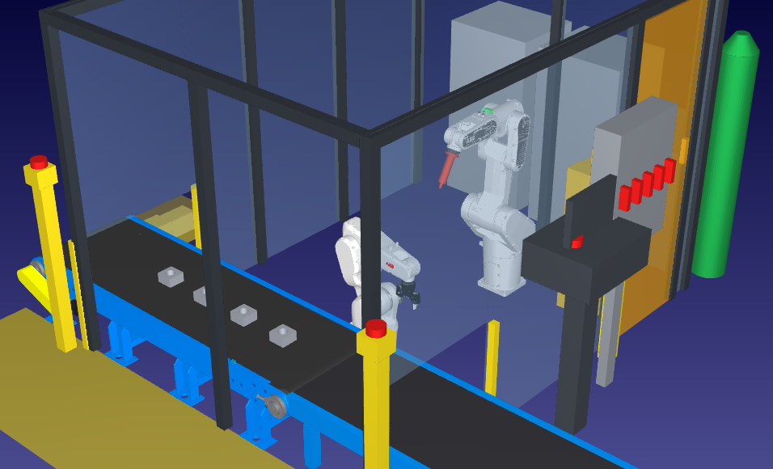

<div align="center">

# Universidad Tecnológica Nacional

**Facultad Regional Córdoba**

Licenciatura en Automatización y Control

---

## Robótica Industrial

### Trabajo final: celda robotizada de soldadura TIG de paquetes de estator

Diseño, programación y simulación en RoboDK

---

**Docentes**<br>
Ing. Julián Luque · Lic. Sergio Perassi

**Grupo 4**<br>
Casali Emiliano · Ferrero Facundo · Vera Gonzalo

Comisión 2LA1 · Año 2026

</div>

---

## Índice

- [El trabajo](#el-trabajo)
- [Productos finales](#productos-finales)
- [La celda](#la-celda)
- [Cumplimiento de los requisitos](#cumplimiento-de-los-requisitos)
- [Estructura del repositorio](#estructura-del-repositorio)
- [Versiones de la celda](#versiones-de-la-celda)
- [Cómo abrir y reproducir la celda](#cómo-abrir-y-reproducir-la-celda)
- [Documentación](#documentación)

---

## El trabajo

Este repositorio contiene la solución del grupo al **trabajo de fin de curso** de la cátedra:
diseñar, programar y simular en RoboDK una celda robotizada que cumpla una tarea concreta, con
frames y TCP propios, programas ordenados, al menos una cinta, un segundo robot o variantes de pieza,
y una simulación válida que se repita de forma continua
([lineamientos](a_requisitos/Lineamiento_Trabajo_Final_Robotica.pdf)).

**Tarea de la celda:** soldar con **TIG sin aporte** los **paquetes de chapa de estator** de un motor
universal de lavarropas de ~330 W. Cada paquete lleva cuatro cordones axiales, uno por arista, que
unen las chapas.

## Productos finales

Los entregables están en [`d_presentacion/`](d_presentacion/).

| Producto | Ubicación | Estado |
|---|---|---|
| Celda robotizada final (estación RoboDK con todos los elementos) | [`d_presentacion/`](d_presentacion/) | Copia de la v05 actual |
| Informe técnico final (máximo 8 páginas) | [`Informe_Tecnico_Grupo4.pdf`](d_presentacion/Informe_Tecnico_Grupo4.pdf) | Generado, 7 páginas |
| Video de presentación | `d_presentacion/` | Pendiente: se graba al final, con todo terminado |

El informe de la **entrega anterior** (celda v01) se conserva en [`c_prototipado/docs/antecedentes/`](c_prototipado/docs/antecedentes/).

## La celda



| Elemento | Función |
|---|---|
| **ABB IRB 1200-7/0.7** + pinza **Robotiq 2F-85** | Toma el estator de la cinta, lo presenta al soldador, lo gira 180° y lo devuelve a la cinta |
| **ABB CRB 1300-10/1.15** + **antorcha TIG** | Suelda los cuatro cordones, con MoveL en los cordones y MoveC en la transición entre aristas |
| **Cinta pasante** | Trae los estatores desde afuera de la celda y saca los soldados por el otro lado |
| **Estación de servicio** | Verificación del TCP de la antorcha y cambio de tungsteno |
| **Cerramiento**, **puerta enclavada**, **cortinas de luz** | Seguridad: el operario carga y descarga afuera; solo entra por la puerta con la celda detenida |
| **Panel de operador** | Embebido en la estación: perfiles, modos de mantenimiento, paradas, recuperación, objetivo de piezas e imagen del proceso |

**Ciclo:** ~72 s por pieza, con 42 s de arco; lote de 4 piezas en ~307 s (≈ 47 piezas/h), medido a ×2.
Cordón a 5 mm/s. 0 targets fuera de alcance y programas válidos con la pieza transportada.

**Pendiente:** detención intermitente en el `MoveC` entre cordones, sin causa identificada, y repetir la
batería completa de ensayos sobre la versión final.

## Cumplimiento de los requisitos

| Requisito | Cómo se cumple | Detalle |
|---|---|---|
| MoveJ, MoveL y MoveC bien elegidos | MoveJ en traslados, MoveL en entradas, salidas y cordones, MoveC en la transición entre aristas | [definición, §8](c_prototipado/docs/definicion_celda.md#8-tipos-de-movimiento) |
| Sin Python en los movimientos | Todos los movimientos y eventos son instrucciones nativas de RoboDK. Los scripts solo construyen y verifican la estación, y el panel solo lee y escribe señales | [definición, §7](c_prototipado/docs/definicion_celda.md#7-estructura-de-programas) |
| C1 · Frames y TCP propios | `Frame_Soldadura`, `Frame_Toma_Cinta`, `Frame_Deposito_Cinta`, `Frame_Banda` y otros; TCP en la punta del tungsteno y en los dedos de la pinza | [definición, §5](c_prototipado/docs/definicion_celda.md#5-sistemas-de-referencia-y-tcp) |
| C2 · Programa principal y subprogramas | `Programa_Principal` → `Inicio_Celda`, `Ciclo_Pieza_1…4`, `Fin_Lote` | [definición, §7](c_prototipado/docs/definicion_celda.md#7-estructura-de-programas) |
| C3 · Cinta, segundo robot o variantes | Cinta transportadora (mecanismo, sin Python) y segundo robot | [mejora 01, §6](c_prototipado/docs/mejora_01_cinta_pasante.md#6-requisitos-de-la-cátedra) |
| C4 · Simulación válida | Sin colisiones ni puntos fuera de alcance; dos lotes seguidos en bucle | [mejora 01, §8](c_prototipado/docs/mejora_01_cinta_pasante.md#8-verificación-y-resultados) |

## Estructura del repositorio

```text
proyectoRobotica/
├── a_requisitos/                    Lineamientos del trabajo final (cátedra)
├── b_investigacion/                 Investigación previa al diseño
│   ├── despiece_motor_lavarropas.md   Motor de referencia y ubicación de los cordones
│   ├── bibliografia.md                Bibliografía de la cátedra y normativa
│   ├── conceptos/                     Documentos de conceptos de implementación 00 a 09
│   ├── componentesRDK.md              Catálogo de componentes de RoboDK
│   ├── componentes/                   Imágenes del catálogo
│   ├── img/                           Fotos del motor de referencia
│   └── biblio/                        Libros y clases (no se versiona)
├── c_prototipado/                   Diseño, construcción y verificación de la celda
│   ├── docs/                          Definición, mejoras, modos, panel, manual, informe y antecedentes
│   ├── panel/                         Código del panel de operador; va embebido en la v05
│   ├── Celda_Soldadura_Estator_Grupo4_v01.rdk
│   ├── Celda_Soldadura_Estator_Grupo4_v02.rdk
│   ├── Celda_Soldadura_Estator_Grupo4_v03.rdk
│   ├── Celda_Soldadura_Estator_Grupo4_v04.rdk
│   ├── Celda_Soldadura_Estator_Grupo4_v05.rdk   Versión actual
│   ├── Componentes_Grupo4.rdk         Estación de trabajo con los componentes
│   ├── scripts/                       Parámetros, generación de modelos, construcción y verificación
│   ├── modelos/                       Modelos 3D propios y de la biblioteca de RoboDK
│   ├── verificaciones/                Resultados de los ensayos
│   ├── referencias/                   Panel de la v01 y ejemplo de control de flujo
│   └── imagenes/                      Capturas de la celda y del panel
└── d_presentacion/                  Productos finales: estación e informe; falta el video
```

## Versiones de la celda

| Versión | Archivo | Descripción |
|---|---|---|
| v01 | [`Celda_Soldadura_Estator_Grupo4_v01.rdk`](c_prototipado/Celda_Soldadura_Estator_Grupo4_v01.rdk) | Versión original: posicionador ABB MTD 250 y cilindro de 6 cordones |
| v02 | [`Celda_Soldadura_Estator_Grupo4_v02.rdk`](c_prototipado/Celda_Soldadura_Estator_Grupo4_v02.rdk) | Manipulador + soldador TIG sobre el paquete de estator; entrada por cinta y salida por pallet |
| v03 | [`Celda_Soldadura_Estator_Grupo4_v03.rdk`](c_prototipado/Celda_Soldadura_Estator_Grupo4_v03.rdk) | Cinta pasante: la misma cinta trae y saca las piezas; sin pallet |
| v04 | [`Celda_Soldadura_Estator_Grupo4_v04.rdk`](c_prototipado/Celda_Soldadura_Estator_Grupo4_v04.rdk) | Disposición y posiciones de mantenimiento |
| **v05** | [`Celda_Soldadura_Estator_Grupo4_v05.rdk`](c_prototipado/Celda_Soldadura_Estator_Grupo4_v05.rdk) | **Versión actual.** Coordinador, modos, paradas, recuperación, sensores y panel de operador embebido |

## Cómo abrir y reproducir la celda

**Requisitos:** RoboDK 6.1.1.

> RoboDK tiene que ejecutarse **como administrador** y con conexión a internet. Si no, la licencia
> de prueba no se valida y no permite guardar estaciones con más de un robot.

**Para ver la celda:** abrir `c_prototipado/Celda_Soldadura_Estator_Grupo4_v05.rdk` en RoboDK. El
archivo es autosuficiente:

- **Sin panel:** doble clic en `Programa_Principal`.
- **Con panel:** doble clic en `Coordinador_Panel` y después en `Abrir_Panel_Operador`. Ver el
  [manual](c_prototipado/docs/manual.md).

**Para reproducirla desde los scripts** (con RoboDK abierto):

```text
cd c_prototipado/scripts
python generar_modelos.py                                                   # modelos 3D propios
C:\RoboDK\Python-Embedded\python.exe construir_celda.py                     # estación v02
C:\RoboDK\Python-Embedded\python.exe mejora_01_cinta_pasante.py             # estación v03, a partir de la v02
C:\RoboDK\Python-Embedded\python.exe mejora_02_modos_mantenimiento.py       # estación v04, a partir de la v03
C:\RoboDK\Python-Embedded\python.exe mejora_03_coordinacion.py              # estación v05, a partir de la v04
C:\RoboDK\Python-Embedded\python.exe verificar_coordinacion_v05.py --puerto 20500   # ensayos de la v05
C:\RoboDK\Python-Embedded\python.exe verificar_modos_v05.py --puerto 20500
C:\RoboDK\Python-Embedded\python.exe verificar_paradas_v05.py --puerto 20500
C:\RoboDK\Python-Embedded\python.exe verificar_panel.py --puerto 20500
C:\RoboDK\Python-Embedded\python.exe medir_ciclo_v05.py --puerto 20500        # tiempo de ciclo, a x2
```

Los eventos de simulación (tomar y soltar la pieza, reponer el lote) no se pueden crear desde la API
de RoboDK y se cargan desde la interfaz. El procedimiento está en
[`scripts/parametros_celda.py`](c_prototipado/scripts/parametros_celda.py), en la definición de la
celda y en el documento de la mejora 01.

## Documentación

| Documento | Contenido |
|---|---|
| [Requisitos y trazabilidad](b_investigacion/conceptos/00_requisitos_y_trazabilidad.md) | Requisitos de la cátedra y documento que cubre cada uno |
| [Documentos de conceptos 01 a 09](b_investigacion/conceptos/) | Célula robotizada, soldadura, equipos, frames/TCP, movimientos, programas, seguridad, tiempos e interfaz de operación |
| [09 · Interfaz de operación, usuarios y permisos](b_investigacion/conceptos/09_interfaz_de_operacion_usuarios_y_permisos.md) | Investigación de HMI, perfiles, sesiones y relación con modos; fundamento del panel y su manual |
| [Despiece del motor](b_investigacion/despiece_motor_lavarropas.md) | Motor de referencia y ubicación de los cordones en el paquete de estator |
| [Bibliografía](b_investigacion/bibliografia.md) | Barrientos, Groover, Craig, clases de la cátedra y normativa |
| [Catálogo de componentes](b_investigacion/componentesRDK.md) | Datos, justificación e imágenes de cada componente |
| [Definición de la celda](c_prototipado/docs/definicion_celda.md) | Diseño completo de la celda y su justificación |
| [Informe técnico](d_presentacion/Informe_Tecnico_Grupo4.pdf) | Informe de entrega; sus fuentes están en [docs/informe/](c_prototipado/docs/informe/) |
| [Mejora 01 · Cinta pasante](c_prototipado/docs/mejora_01_cinta_pasante.md) | Cambio de la v02 a la v03 |
| [Modos y mantenimiento](c_prototipado/docs/modos_y_mantenimiento.md) | Paradas, LOTO, energías, zonas, modos y tareas |
| [Mejora 02 · Modos y mantenimiento](c_prototipado/docs/mejora_02_modos_mantenimiento.md) | Cambio de la v03 a la v04 |
| [Panel de operador y sensores](c_prototipado/docs/panel_y_sensores.md) | Trazabilidad desde los requisitos y la investigación, revisión del antecedente v01 y propuesta de modos, mantenimiento y señales; implementación pendiente |
| [Manual del panel](c_prototipado/docs/manual.md) | Puesta en marcha y operación de la v05, con el panel o sin él |
