

**UNIVERSIDAD TECNOLÓGICA NACIONAL** 
**Facultad Regional Córdoba** 
Licenciatura en Automatización y Control

---

**Cátedra: Robótica Industrial** 
Trabajo final: celda robotizada de soldadura

# Componentes de la celda en RoboDK

*Catálogo de componentes*

**Grupo 4** 
Casali Emiliano · Ferrero Facundo · Vera Gonzalo

**Docentes** 
Ing. Julián Luque · Lic. Sergio Perassi

Comisión 2LA1 · Año 2026

---

## Índice

- [Prólogo](#prólogo)
- [1. Resumen de componentes](#1-resumen-de-componentes)
- [2. Robot soldador: ABB CRB 1300-10/1.15](#2-robot-soldador-abb-crb-1300-10115)
- [3. Antorcha TIG (modelo propio)](#3-antorcha-tig-modelo-propio)
- [3 bis. Estación de servicio de la antorcha](#3-bis-estación-de-servicio-de-la-antorcha)
- [4. Robot manipulador: ABB IRB 1200-7/0.7](#4-robot-manipulador-abb-irb-1200-707)
- [5. Pinza: Robotiq 2F-85](#5-pinza-robotiq-2f-85)
- [6. Pieza: paquete de estator](#6-pieza-paquete-de-estator)
- [7. Cinta transportadora de entrada](#7-cinta-transportadora-de-entrada)
- [8. Sensor láser de presencia](#8-sensor-láser-de-presencia)
- [9. Pallet de salida de 4 posiciones](#9-pallet-de-salida-de-4-posiciones)
- [10. Mesa](#10-mesa)
- [11. Cerramiento y puerta](#11-cerramiento-y-puerta)
- [12. Versión anterior: posicionador ABB MTD 250](#12-versión-anterior-posicionador-abb-mtd-250)
- [13. Verificaciones de carga y alcance](#13-verificaciones-de-carga-y-alcance)
- [14. Archivos y cómo regenerarlos](#14-archivos-y-cómo-regenerarlos)
- [15. Cambios en la v03 (mejora 01)](#15-cambios-en-la-v03-mejora-01)
- [16. Referencias](#16-referencias)

---

## Prólogo

Este documento reúne todos los componentes que se usan (o se crean) en la estación de RoboDK, con
sus datos y una imagen de cada uno. Sirve para tres cosas:

- **Justificar** el robot, la herramienta y los periféricos en el informe, con los criterios de
  [03 · Selección de equipos](conceptos/03_seleccion_de_equipos.md).
- **Reproducir** la estación: cada componente indica de dónde sale (biblioteca de RoboDK o modelo
  propio) y cómo se regenera.
- **Mantener una única fuente** de medidas y datos para la definición de la celda.

La configuración elegida es la **C: un robot manipulador que toma el paquete de estator de una
cinta, lo presenta y lo gira frente a un robot soldador, y lo deposita en un pallet de salida**.
La estación anterior resolvía el giro de la pieza con un posicionador (sección 12). El manipulador
con pinza agrega lo que el posicionador no podía hacer: **tomar la pieza de una cinta y depositarla
en otro lugar**. Por eso se plantea como una mejora respecto de esa versión.

Las imágenes se generaron en RoboDK v6.1.1 a partir de los modelos de la biblioteca y de los
modelos propios, y están en [`componentes/`](componentes/).

> Los datos marcados como **(estimado)** salen de fotos o de un orden de magnitud y deben
> confirmarse. Los marcados como **(fabricante, a confirmar)** no salen de la biblioteca de RoboDK
> sino de la documentación general del fabricante y no fueron verificados en su hoja de datos.

---

## 1. Resumen de componentes

| # | Componente | Función en la celda | Origen | Estado |
|---|---|---|---|---|
| 2 | ABB CRB 1300-10/1.15 | Robot soldador | Biblioteca RoboDK | Se reutiliza de la versión anterior |
| 3 | Antorcha TIG | Antorcha de soldadura TIG sin aporte | **Modelo propio** | **Nuevo** (reemplaza a la antorcha MIG de la versión anterior) |
| 3 bis | Estación de servicio de la antorcha | Cambio del tungsteno y verificación del TCP | **Modelo propio** | **Nuevo** |
| 4 | ABB IRB 1200-7/0.7 | Robot manipulador: toma, presenta, gira y deposita la pieza | Biblioteca RoboDK | **Nuevo** |
| 5 | Robotiq 2F-85 (mecanismo) | Pinza del manipulador | Biblioteca RoboDK | **Nuevo**. Hay que crearle el TCP |
| 6 | Paquete de estator | Pieza a soldar | **Modelo propio** | **Nuevo** (reemplaza al cilindro) |
| 7 | Cinta transportadora (ConveyorA) | Entrada de piezas | Biblioteca RoboDK (ejemplo 17) | **Nuevo** |
| 8 | Sensor láser | Detecta la pieza al final de la cinta | Biblioteca RoboDK (ejemplo 17) | **Nuevo** |
| 9 | Pallet de 4 posiciones | Salida de piezas soldadas | **Modelo propio** | **Nuevo** |
| 10 | Mesa 1400 × 800 × 800 mm | Soporte del pallet o de un robot | Biblioteca RoboDK | **Nuevo** |
| 11 | Cerramiento y puerta | Protección de nivel 1 | Modelo propio (versión anterior) | Hay que redimensionarlo |
| 12 | ABB MTD 250 | Posicionador de la versión anterior | Biblioteca RoboDK | **Sale de la celda** |

---

## 2. Robot soldador: ABB CRB 1300-10/1.15

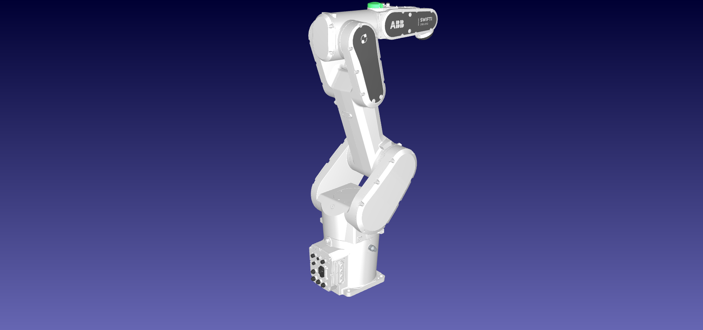

| Dato | Valor | Fuente |
|---|---|---|
| Tipo | Robot articulado de 6 ejes (línea SWIFTI) | Biblioteca RoboDK |
| Alcance | 1150 mm | Biblioteca RoboDK |
| Carga útil | 10 kg | Biblioteca RoboDK |
| Repetibilidad | 0,023 mm | Biblioteca RoboDK |
| Peso | 77 kg | Biblioteca RoboDK |
| Archivo | `ABB-CRB-1300-10-1-15.robot` | Biblioteca RoboDK |

**Límites articulares** (leídos del modelo con la API de RoboDK):

| Eje | J1 | J2 | J3 | J4 | J5 | J6 |
|---|---|---|---|---|---|---|
| Mínimo [°] | −180 | −95 | −210 | −230 | −130 | −242 |
| Máximo [°] | 180 | 155 | 65 | 230 | 130 | 242 |

**Por qué se elige:** cumple lo que pide la soldadura al arco: 6 GDL, control de trayectoria
continua, carga baja y buena repetibilidad (ver [02](conceptos/02_soldadura_robotizada.md) y
[03](conceptos/03_seleccion_de_equipos.md)). Su repetibilidad (0,023 mm) está muy por debajo de la
tolerancia de posición de un cordón. Ya está integrado con la antorcha en la versión anterior.

## 3. Antorcha TIG (modelo propio)

| Montada en el CRB 1300 | Detalle |
|---|---|
| 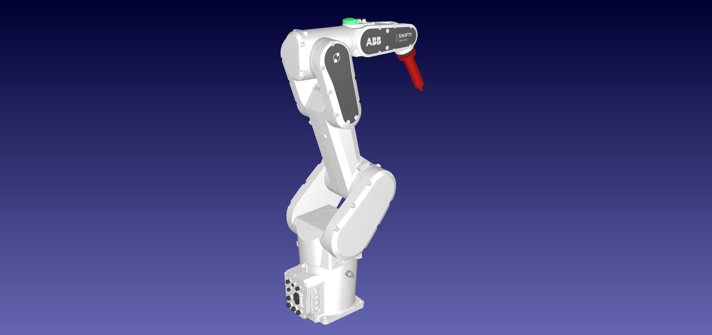 | 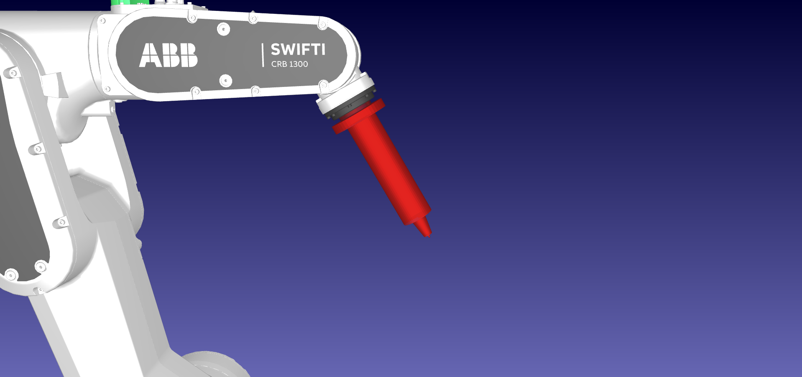 |

| Dato | Valor | Fuente |
|---|---|---|
| Proceso | TIG **sin material de aporte** (fusión de los bordes de las chapas) | Decisión del grupo |
| Tipo | Antorcha recta, refrigerada | Modelo propio simplificado |
| Placa de montaje | Ø80 × 12 mm | Modelo propio |
| Cuerpo | Ø45 × 160 mm | Modelo propio |
| Boquilla cerámica | Cónica, Ø22 a Ø13 mm, 30 mm de largo | Modelo propio |
| Electrodo de tungsteno | Ø2,4 mm | Valor típico |
| Saliente del tungsteno | 5 mm fuera de la boquilla | Valor típico |
| **TCP** | **X = 0, Y = 0, Z = 207 mm** desde la brida, sin rotación (Z a lo largo del electrodo) | Modelo propio |
| Archivo | `c_prototipado/modelos/antorcha_tig.stl` | `generar_modelos.py` |

**Por qué TIG y no MIG:** para un paquete de chapas magnéticas importa que la soldadura tenga **poco
calor y no agregue material**. El TIG sin aporte funde los bordes de las chapas entre sí, deja un
cordón fino al ras del escalón y no salpica. El MIG agrega metal: el cordón sobresale y las
salpicaduras pueden unir eléctricamente las chapas. Además, el cordón del motor de referencia no
muestra aporte (ver [despiece, §4](despiece_motor_lavarropas.md) y
[02](conceptos/02_soldadura_robotizada.md)).

**Justificación del TCP:** el TCP está **en la punta del tungsteno**, que es el punto desde el que
se establece el arco. Con el eje Z a lo largo del electrodo, la orientación de cada target expresa
directamente el ángulo de la antorcha respecto del cordón, y la distancia de arco (~2 mm) se fija
en los targets, separándolos de la superficie de la pieza (ver
[04](conceptos/04_sistemas_de_referencia_y_tcp.md)).

**El TCP depende del tungsteno:** si el electrodo se gasta, se reafila o se cambia, varía su
saliente y **se mueve el TCP**. Por eso la celda incluye una estación de servicio con verificación
del TCP (sección 3 bis).

**Antorcha de la versión anterior:** la estación anterior usaba la `Generic Welding Gun (Over-arm)`
de la biblioteca de RoboDK, una antorcha MIG con alimentación de alambre y cuello curvo (TCP en
−4 / 0 / 371,3 mm, rotada 45° en Y). Se reemplaza porque no corresponde al proceso elegido.

| Antorcha MIG de la versión anterior |
|---|
| 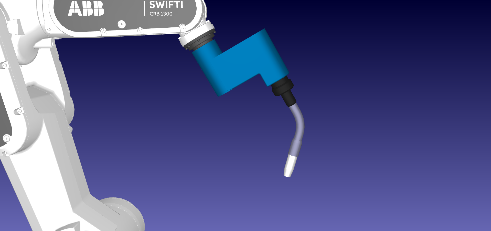 |

## 3 bis. Estación de servicio de la antorcha

| Vista general | Detalle de la verificación del TCP |
|---|---|
| 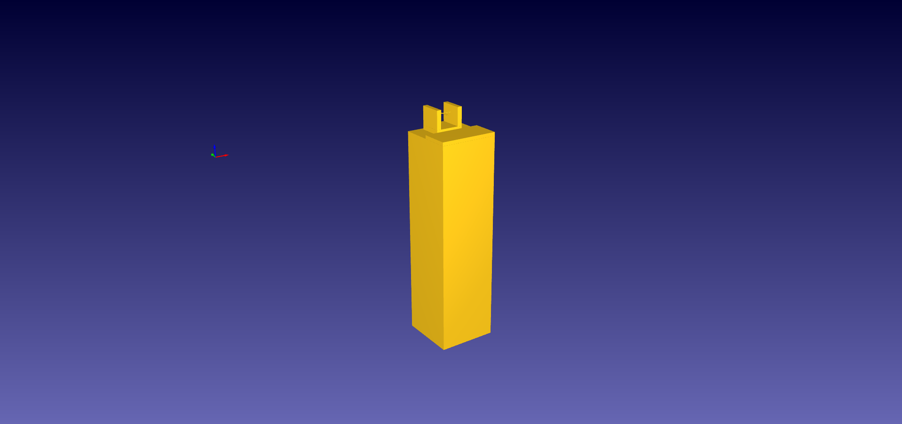 | 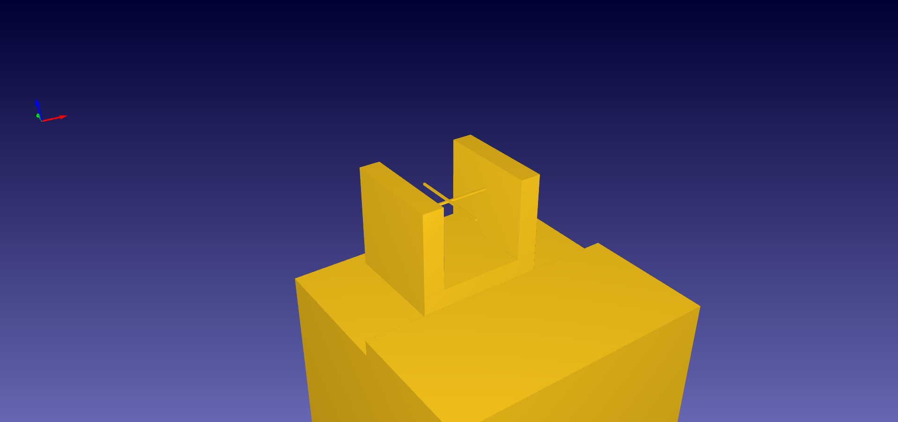 |

| Dato | Valor | Fuente |
|---|---|---|
| Pedestal | 250 × 250 × 900 mm | Modelo propio |
| Bandeja de servicio | 250 × 120 × 15 mm, a 900 mm de altura | Modelo propio |
| Horquilla de verificación del TCP | Dos brazos con dos haces cruzados | Modelo propio, inspirado en los dispositivos comerciales de verificación de TCP |
| Punto de verificación | (0, 60, 970) mm respecto de la base del pedestal | Modelo propio |
| Archivo | `c_prototipado/modelos/estacion_servicio_antorcha.stl` | `generar_modelos.py` |

**Función:**

1. **Cambio del tungsteno.** Cada N piezas (contador en el programa principal), el robot lleva la
   antorcha a la posición de servicio, sobre la bandeja, y la celda se detiene. El operario entra
   con la puerta abierta y el robot detenido, reafila o cambia el electrodo y ajusta la saliente.
2. **Verificación del TCP.** Al reanudar, el robot pasa la punta del tungsteno por el cruce de los
   haces. En una celda real, el dispositivo mide la diferencia entre el TCP programado y el real.
   En la simulación es un punto de verificación del programa.

**Por qué se agrega:**

- **Proceso:** el TCP de una antorcha TIG cambia con el desgaste del tungsteno, y la distancia de
  arco es una variable del cordón (ver [02](conceptos/02_soldadura_robotizada.md)).
- **Seguridad:** según Barrientos, el 90 % de los accidentes ocurre durante el mantenimiento, el
  ajuste o la programación. Definir una posición y un procedimiento de servicio permite hacerlo con
  la celda detenida y en un punto accesible desde la puerta (ver
  [07](conceptos/07_seguridad_y_normativa.md)).
- **Programación:** es lógica de programa de RoboDK (contador, llamada a subprograma, pausa), sin
  Python.

## 4. Robot manipulador: ABB IRB 1200-7/0.7

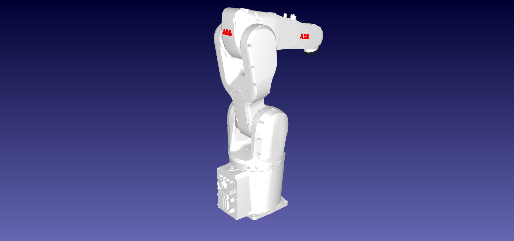

| Dato | Valor | Fuente |
|---|---|---|
| Tipo | Robot articulado de 6 ejes, compacto | Biblioteca RoboDK |
| Alcance | 703 mm | Biblioteca RoboDK |
| Carga útil | 7 kg | Biblioteca RoboDK |
| Repetibilidad | 0,02 mm | Biblioteca RoboDK |
| Peso | 54 kg | Biblioteca RoboDK |
| Archivo | `ABB-IRB-1200-7-0-7.robot` | Biblioteca RoboDK |

**Límites articulares** (leídos del modelo):

| Eje | J1 | J2 | J3 | J4 | J5 | J6 |
|---|---|---|---|---|---|---|
| Mínimo [°] | −170 | −100 | −200 | −270 | −130 | −360 |
| Máximo [°] | 170 | 135 | 70 | 270 | 130 | 360 |

**Por qué se elige:**

- **Carga:** 7 kg alcanzan para la pieza más la pinza (sección 13).
- **Giro de la pieza:** el **J6 tiene ±360°**. Si la pieza se toma con su eje alineado con el de la
  brida, el J6 la gira para presentar cada arista a la antorcha, como lo hacía el posicionador.
- **Tamaño:** es compacto y de la misma marca que el soldador, lo que simplifica la integración.
- **Limitación:** su alcance es corto (703 mm). La cinta, la zona de soldadura y el pallet tienen
  que quedar cerca de su base.

## 5. Pinza: Robotiq 2F-85

| Montada en el IRB 1200 | Detalle |
|---|---|
| 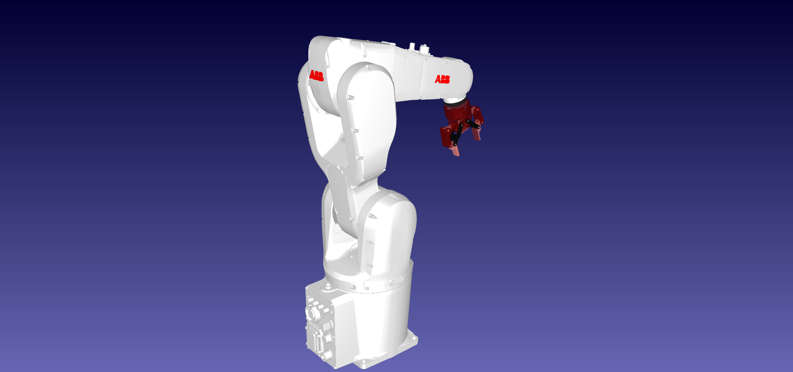 | 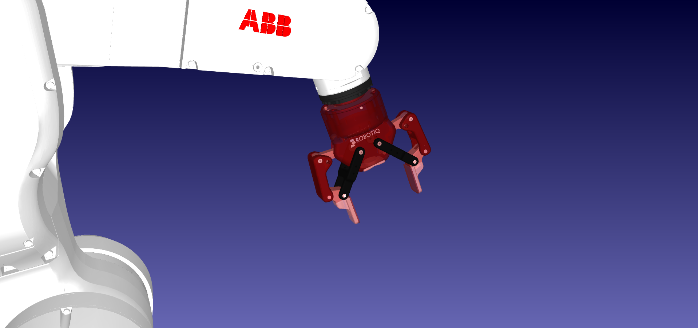 |

| Dato | Valor | Fuente |
|---|---|---|
| Tipo | Pinza eléctrica de 2 dedos paralelos, modelada como **mecanismo de 1 eje** | Biblioteca RoboDK |
| Carrera (apertura) | 0 a 85 mm | Modelo (API) |
| Archivo | `RobotiQ-2F-85-Gripper-Mechanism.robot` | Biblioteca RoboDK |
| Peso | ~0,9 kg | Fabricante, a confirmar |
| Carga | ~5 kg | Fabricante, a confirmar |

**Cómo toma la pieza:** con **agarre interior**: los dedos entran cerrados en el agujero central
(Ø55 mm) y se abren contra la pared. Así quedan libres las cuatro caras exteriores y las cuatro
aristas donde van los cordones. La carrera de 85 mm es mayor que el diámetro del agujero.

**A resolver en la estación:**

- El modelo es un mecanismo y **no trae TCP**. Hay que crear una herramienta en la brida del
  IRB 1200 con el TCP en el centro de los dedos.
- La apertura y el cierre se representan moviendo el eje del mecanismo desde un programa de RoboDK
  (no con Python), y la pieza se "toma" asociándola a la herramienta.

## 6. Pieza: paquete de estator

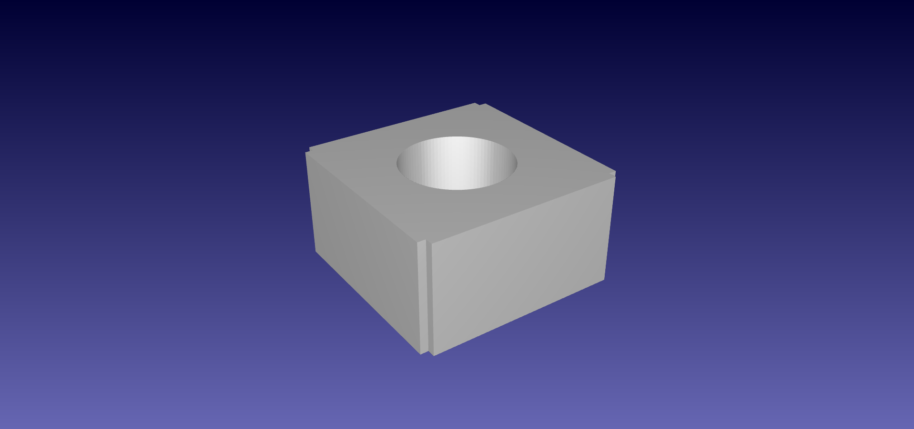

| Dato | Valor | Fuente |
|---|---|---|
| Descripción | Paquete de chapas de acero al silicio, sin bobinar, de un motor universal de lavarropas | [Despiece](despiece_motor_lavarropas.md) |
| Sección exterior | 105 × 105 mm | Adoptado (medida de diseño) |
| Largo de apilado | 55 mm | Adoptado |
| Agujero central | Ø55 mm | Adoptado |
| Escalón en cada arista | 4 × 4 mm | Adoptado |
| Masa | 3,6 kg (acero al silicio, 7,65 g/cm³) | Calculado sobre las medidas adoptadas |
| Cordones | 4 axiales, uno por arista, cada 90°, de 53 mm (1 mm de margen en cada cara) | Adoptado ([despiece, §4](despiece_motor_lavarropas.md)) |
| Archivo | `c_prototipado/modelos/paquete_estator.stl` | Modelo propio |

**Por qué se modela así:** reemplaza al cilindro `generator_assembly` de la versión anterior, que
no correspondía a la pieza real. El escalón en las aristas reproduce el rebaje donde se ubica el
cordón en el motor de referencia. El origen del modelo está en el centro de la cara inferior, con Z
a lo largo del eje del paquete.

## 7. Cinta transportadora de entrada

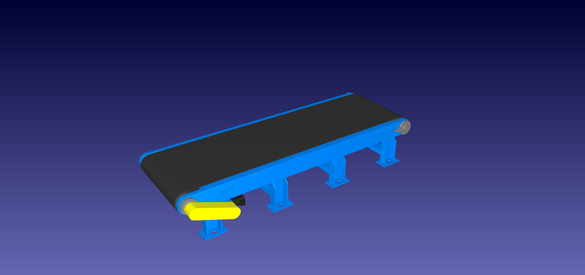

| Dato | Valor | Fuente |
|---|---|---|
| Tipo | Cinta modelada como **mecanismo de 1 eje lineal** | Biblioteca RoboDK, ejemplo 17 *Conveyor Swap* |
| Recorrido del eje | ±900 m (sin límite práctico) | Modelo (API) |
| Dimensiones | Banda de 600 mm de ancho y ~2050 mm de largo; ~680 mm de ancho total | Medido sobre el modelo |
| Archivo | `C:\RoboDK\Library\17-Conveyor Swap\Parts\Conveyor.robot` | Biblioteca local |

**Función:** traer los paquetes de estator a la zona de toma del manipulador. El operario carga la
cinta **fuera del cerramiento**, que es la medida de seguridad de Barrientos para no entrar en el
área de trabajo del robot (ver [07](conceptos/07_seguridad_y_normativa.md)).

**Requisito C3:** los lineamientos piden que una cinta se modele como mecanismo y se mueva **sin
Python**. Este modelo cumple: el eje lineal se mueve con instrucciones de programa de RoboDK, igual
que en el ejemplo 17.

**Ejemplo de partida:** el ejemplo 17 *Conveyor Swap* de la biblioteca usa un ABB CRB 1300 con esta
cinta y un sensor láser. Es un candidato para declararlo como ejemplo de partida del trabajo.

## 8. Sensor láser de presencia

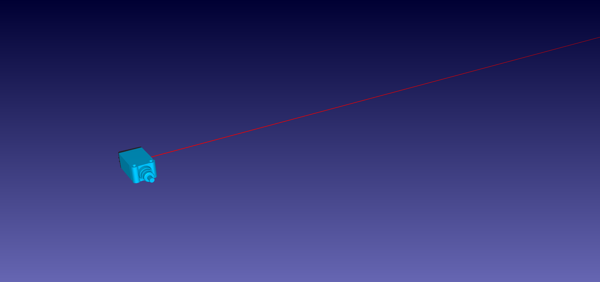

| Dato | Valor | Fuente |
|---|---|---|
| Tipo | Sensor láser de barrera o reflexión, con el haz modelado como geometría | Biblioteca RoboDK, ejemplo 17 |
| Dimensiones | ~45 × 12 mm de cuerpo; haz de ~0,6 m | Modelo |
| Archivo | `C:\RoboDK\Library\17-Conveyor Swap\Parts\Laser-Sensor.stl` | Biblioteca local |

**Función:** detectar que llegó un paquete de estator al final de la cinta, para detenerla y
habilitar la toma. Es un **sensor adicional**, así que su lógica puede hacerse en Python según los
lineamientos. El robot no se mueve desde ese script: el programa de RoboDK solo espera su señal.

## 9. Pallet de salida de 4 posiciones

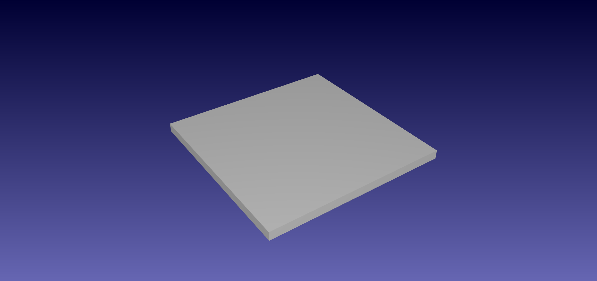

| Dato | Valor | Fuente |
|---|---|---|
| Dimensiones | 400 × 400 × 20 mm | Modelo propio |
| Posiciones | 4 (2 × 2), separadas 200 mm | Modelo propio |
| Archivo | `c_prototipado/modelos/pallet_4_posiciones.stl` | Modelo propio |

**Función:** recibir las piezas soldadas. Las 4 posiciones son una **variante de patrón** (requisito
C3, "un pallet con varias posiciones"): el subprograma de depósito es el mismo, y cambia solo el
frame o el target de cada posición. Cuando el pallet se llena, el operario lo retira desde afuera.

## 10. Mesa

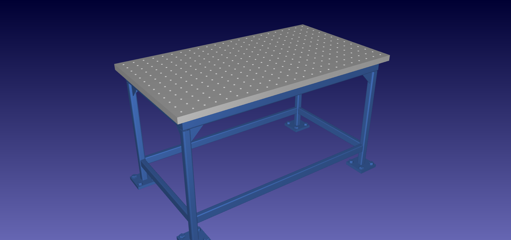

| Dato | Valor | Fuente |
|---|---|---|
| Dimensiones | 1400 × 800 × 800 mm | Biblioteca RoboDK (ejemplos 02, 03, 06 y 07) |
| Origen del modelo | En la superficie superior | Modelo |
| Archivo | `C:\RoboDK\Library\06-Pick and Place\Parts\Table-1400x800x800mm.stl` | Biblioteca local |

**Función:** soporte del pallet de salida y, si hace falta, de los robots, para que la zona de
trabajo quede a una altura cómoda. La versión anterior usaba una mesa de 2000 × 1200 × 800 mm con
los dos equipos encima.

## 11. Cerramiento y puerta

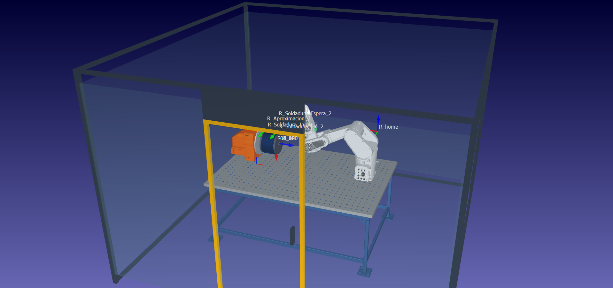

| Dato | Valor | Fuente |
|---|---|---|
| Dimensiones (versión anterior) | 3500 × 3500 × 2400 mm | Informe de la versión anterior |
| Composición | Postes, largueros, paneles laterales y trasero, puerta frontal con bisagra animada | Estación anterior (`Marco_Celda_2400`) |
| Estado | **Hay que redimensionarlo** para la nueva disposición, con aberturas para la cinta de entrada y el pallet de salida | — |

**Función:** protección de nivel 1 (ver [07](conceptos/07_seguridad_y_normativa.md)): aísla la
zona de los robots y del arco. La puerta tiene enclavamiento: abrirla detiene el ciclo. Las
aberturas para la cinta y el pallet permiten cargar y descargar sin entrar.

## 12. Versión anterior: posicionador ABB MTD 250

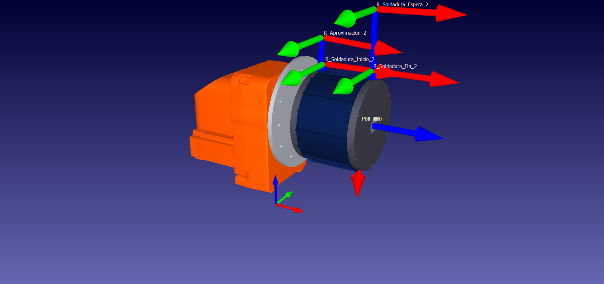

| Dato | Valor | Fuente |
|---|---|---|
| Tipo | Posicionador de 1 eje rotativo, cargado en RoboDK **como un robot de 1 eje** | Estación anterior |
| Carga | 250 kg (designación del modelo) | Biblioteca RoboDK |
| Recorrido del eje | ±3600° | Modelo (API) |
| Pieza | `generator_assembly` (cilindro), montada **como herramienta** del posicionador, con el TCP a 200 mm de la brida | Estación anterior |

**Cómo funcionaba:** el frame `Ref_Soldadura_Cilindro` colgaba del eje del posicionador, y los
targets P01_0 a P06_300 eran posiciones articulares del eje (0°, 60°, …, 300°). Como la pieza giraba,
el robot soldador repetía siempre el mismo cordón en la misma posición del espacio. Es una solución
**simple y válida** para presentar cada cara de la pieza.

**Por qué se reemplaza:**

| | Posicionador MTD 250 | Manipulador IRB 1200 + pinza |
|---|---|---|
| Girar la pieza para presentar cada cordón | Sí | Sí (J6) |
| Tomar la pieza de una cinta | **No** | **Sí** |
| Depositarla en un pallet o en otra cinta | **No** | **Sí** |
| Carga y descarga | Manual, dentro del cerramiento | Automática; el operario trabaja afuera |
| Dimensionamiento | Muy sobredimensionado (250 kg para 3,6 kg) | Adecuado (7 kg para ~4,5 kg) |
| Requisito C3 | No aporta | Segundo robot |

El manipulador **conserva la idea** de la versión anterior (la pieza gira y el soldador repite el
cordón) y le agrega el transporte de la pieza. En el informe se presenta como la **mejora principal**
respecto de la versión anterior.

## 13. Verificaciones de carga y alcance

| Verificación | Cálculo | Resultado |
|---|---|---|
| Carga del IRB 1200 | Pieza 3,6 kg + pinza ~0,9 kg = **~4,5 kg** ≤ 7 kg | Cumple, con margen. Falta verificar el momento por la distancia del centro de gravedad a la brida. |
| Carga de la pinza | Pieza 3,6 kg ≤ ~5 kg | Cumple. El agarre interior en el agujero da sujeción por forma. |
| Carga del CRB 1300 | Antorcha TIG (masa no modelada; una antorcha TIG robotizada pesa del orden de 1 kg) ≤ 10 kg | Cumple, con mucho margen. |
| Alcance del IRB 1200 | 703 mm | Condiciona la disposición: cinta, zona de soldadura y pallet cerca de su base. Se verifica en la estación. |
| Alcance del CRB 1300 | 1150 mm | Holgado para una zona de soldadura de ~100 mm. |
| Apertura de la pinza | 85 mm > Ø55 mm del agujero | Cumple. |

## 14. Archivos y cómo regenerarlos

| Archivo | Cómo se obtiene |
|---|---|
| `c_prototipado/modelos/paquete_estator.stl` | `python c_prototipado/scripts/generar_modelos.py` |
| `c_prototipado/modelos/pallet_4_posiciones.stl` | Mismo script |
| `c_prototipado/modelos/antorcha_tig.stl` | Mismo script |
| `c_prototipado/modelos/estacion_servicio_antorcha.stl` | Mismo script |
| `c_prototipado/Componentes_Grupo4.rdk` | Estación de trabajo con todos los componentes cargados y configurados (antorcha TIG con su TCP, pinza montada en el IRB 1200) |
| Robots, antorcha y pinza | Biblioteca de RoboDK (<https://robodk.com/library>) |
| Cinta, sensor y mesa | Biblioteca local de RoboDK (`C:\RoboDK\Library`) |
| Imágenes de `componentes/` | Capturas de RoboDK v6.1.1 (estación de trabajo `Componentes_Grupo4`) |

El script `generar_modelos.py` solo escribe archivos STL: no se conecta con RoboDK ni mueve ningún
robot.

## 15. Cambios en la v03 (mejora 01)

La v03 reemplaza la salida por pallet por una **cinta pasante** (ver
[`mejora_01_cinta_pasante.md`](../c_prototipado/mejora_01_cinta_pasante.md)).

| Componente | v02 | v03 | Archivo |
|---|---|---|---|
| Pallet de 4 posiciones y su soporte (§9) | Sí | **Se quita** | `pallet_4_posiciones.stl`, `soporte_pallet.stl` |
| Cortina de la ventana del pallet (§11) | Sí | **Se quita** | `cortina_luz.stl` |
| Cinta ConveyorA (§7) | Entrada | **Entrada y salida**, renombrada `Cinta_Pasante` | `Conveyor.robot` |
| **Tramo de salida de la cinta** | — | **Nuevo:** prolonga la banda (600 mm de ancho, cara superior a 366,5 mm) hasta x = 2100 mm, afuera de la cara este | `cinta_extension_banda.stl`, `cinta_extension_estructura.stl` |
| **Cortinas de luz de la cinta** | — | **Nuevas:** una en la entrada (oeste) y otra en la salida (este) | `cortina_luz_cinta.stl` |
| Cerramiento (§11) | Ventana del pallet en la cara este | **Abertura de salida de la cinta** en la cara este | `cerramiento_*_v03.stl` |

El tramo de salida es geometría fija. Lo que viaja sobre la banda lo mueve el único eje del
mecanismo de la cinta, como en una cinta real con un solo accionamiento.

| Salida de la cinta con su cortina (v03) |
|---|
| 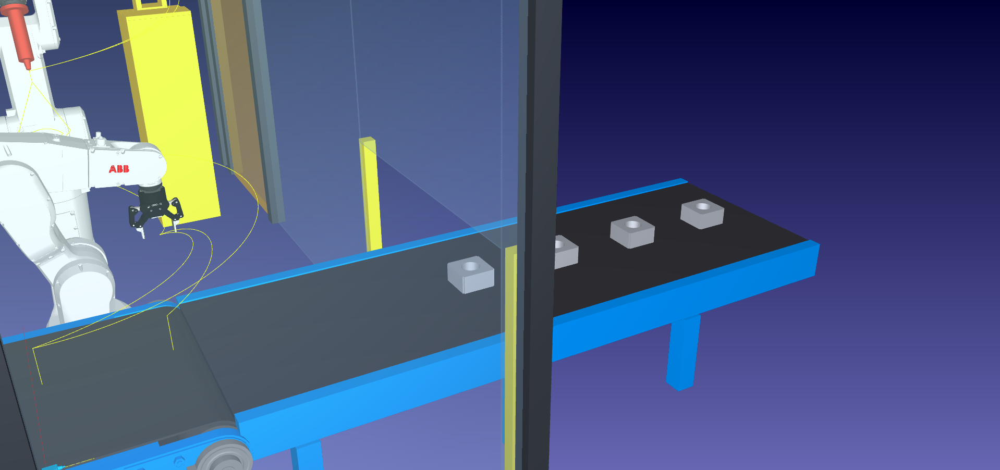 |

## 16. Referencias

- RoboDK. *ABB CRB 1300-10/1.15*. Biblioteca de robots. <https://robodk.com/robot/ABB/CRB-1300-10-1-15>
- RoboDK. *ABB IRB 1200-7/0.7*. Biblioteca de robots. <https://robodk.com/robot/ABB/IRB-1200-7-0-7>
- RoboDK. *RobotiQ 2F-85 Gripper (Mechanism)*. Biblioteca de herramientas.
  <https://robodk.com/3D/tool/RobotiQ-2F-85-Gripper-Mechanism.robot>
- RoboDK. *Generic Welding Gun (Over-arm)*. Biblioteca de herramientas (antorcha de la versión
  anterior).
- RoboDK. Ejemplo 17 *Conveyor Swap* (`Conveying-with-ABB-CRB-1300-7-1-4.rdk`). Biblioteca local,
  v6.1.1.
- Grupo 4. *Despiece del motor de lavarropas*. [`despiece_motor_lavarropas.md`](despiece_motor_lavarropas.md).
- Grupo 4. Documentos de conceptos de implementación [00 a 08](conceptos/00_requisitos_y_trazabilidad.md).
