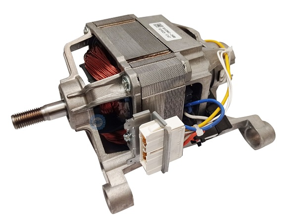
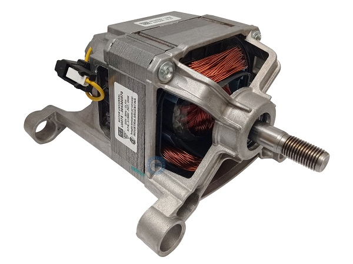
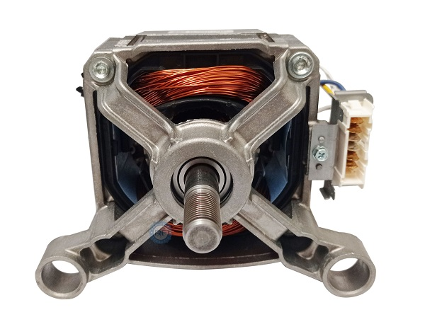
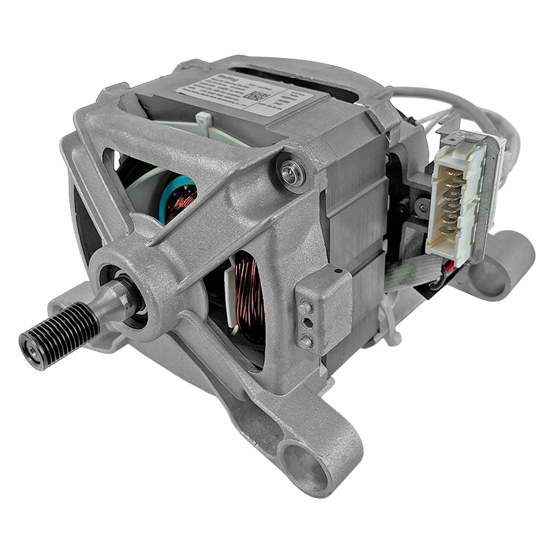
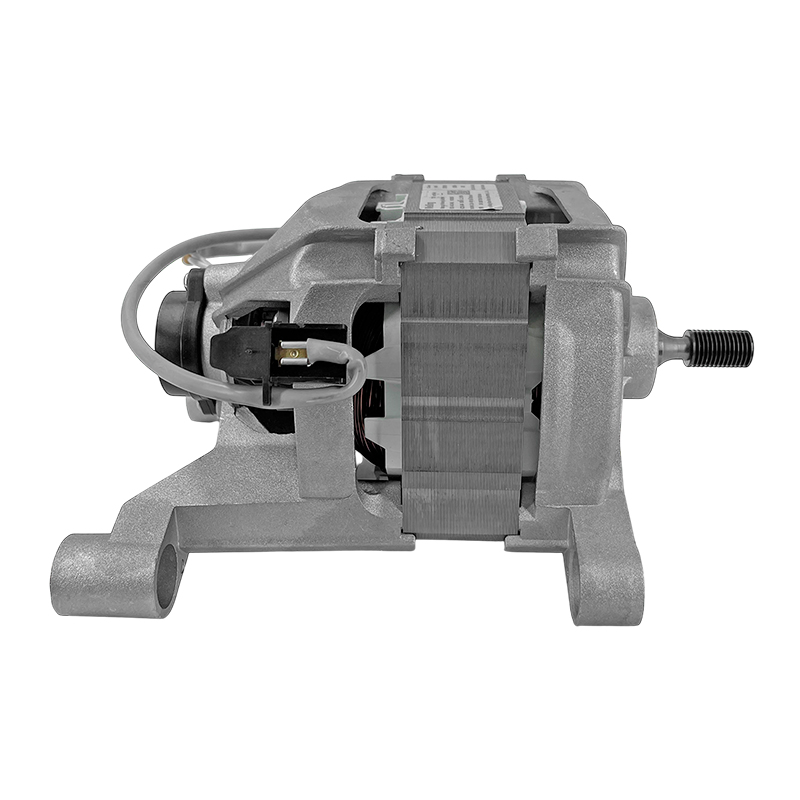
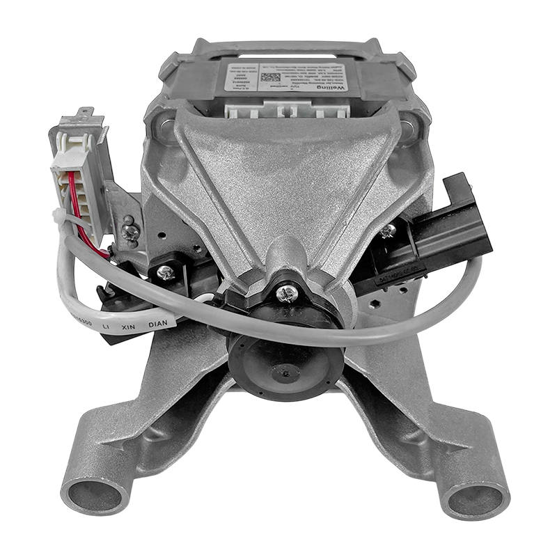
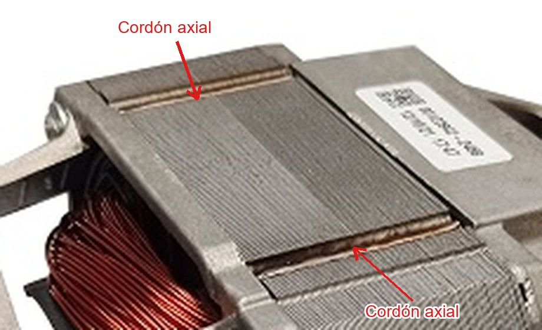

# Despiece del motor de lavarropas (referencia para la celda)

Documento de investigación interno. Sirve para definir la pieza que suelda la celda y su escala.
Equipo de referencia: motores de los lavarropas automáticos de carga frontal Drean / Alladio
(uso interno; en el informe no se menciona la marca).

> **Nota:** no hay un despiece oficial (vista explosionada con códigos) publicado en internet. Para
> conseguirlo habría que pedir el manual de servicio al servicio técnico o desarmar un motor. El
> despiece de abajo se armó a partir de fotos de repuestos, de los avisos de los vendedores y de la
> estructura típica de un motor universal de lavarropas.

## 1. Motor de referencia: WEG U0075

En Argentina, los lavarropas automáticos de Drean usan motores **WEG de fabricación nacional**. El
repuesto más común es el **WEG U0075**, vendido como "motor WEG (U0075) lavarropa automático
Drean 6 kg (6 contactos)". La etiqueta de las fotos tiene el logo de WEG y la leyenda
"Industria Argentina".

| Vista 3/4 lado conector | Vista 3/4 lado eje | Vista frontal |
|---|---|---|
|  |  |  |

*Fotos: Repuestos Refrigeración (Rosario).*

| Dato | WEG U0075 | WEG U0080 |
|---|---|---|
| Tipo | Universal (colector y escobillas) | Universal |
| Potencia | 330 W | 340 W |
| Tensión / frecuencia | 220 V, 50 Hz | 220 V |
| Uso | Carga frontal hasta 6–7 kg | Carga frontal 7–8 kg |
| Conexión | Ficha de 6 contactos | Ficha de 7 contactos |
| Centrifugado (tambor) | — | Hasta 1400 rpm |
| Polea | — | Ø19 mm |

La U de la denominación coincide con "universal". En los avisos del motor **Drean Blue 8.12** también
figura "Marca WEG". Los modelos Inverter más nuevos (por ejemplo, Next 8.14) usan otro tipo de motor
y quedan fuera de este análisis.

## 2. Comparación con un motor equivalente (Welling)

Para la misma línea (Next / Blue 6.06P) también se vende un repuesto **Welling** (fabricante
chino): 300 W, 220 V, 50/60 Hz, ficha de 6 palas, polea de 23 mm de largo y Ø15 mm, eje saliente de
39 mm.

| Vista 3/4 | Lateral | Trasera (tacogenerador) |
|---|---|---|
|  |  |  |

*Fotos: Norfrig. Más vistas en [img/](img/) (`motor_repuesto_01.jpg` a `_08.jpg`).*

**Son motores prácticamente iguales.** Tienen la misma arquitectura y casi la misma potencia:

| Característica | WEG U0075 | Welling |
|---|---|---|
| Tipo | Universal | Universal |
| Potencia | 330 W | 300 W |
| Escudos | Dos tapas de aluminio inyectado con patas de montaje y tornillos pasantes | Igual |
| Estator | Paquete de chapas casi cuadrado, a la vista entre las tapas | Igual |
| Rotor | Inducido bobinado con colector | Igual |
| Conexión | Ficha de 6 contactos al costado | Ficha de 6 palas al costado |
| Eje | Saliente roscado/estriado para la polea | Igual |

Por lo tanto, **lo que vale para uno vale para el otro**. La pieza de la celda puede modelarse
como un rotor genérico de esta familia.

## 3. Despiece

| # | Pieza | Descripción | ¿Lleva soldadura en fabricación? |
|---|---|---|---|
| 1 | Carcasa / escudos | Dos tapas de aluminio inyectado con las patas de montaje y los alojamientos de los rodamientos. Se unen con tornillos pasantes (se ven en la vista frontal del U0075). | No (se atornillan) |
| 2 | **Paquete de estator** | Chapas de acero al silicio apiladas, de forma casi cuadrada (se ve el apilado en `weg_u0075_01.jpg` y `motor_repuesto_03.jpg`). Lleva las bobinas de campo. | **Sí, esta es la soldadura de la celda:** cordones axiales sobre las aristas del paquete que unen las chapas (ver sección 4) |
| 3 | Bobinas de campo | Bobinado de cobre esmaltado sobre los polos del estator (el cobre que se ve por las ventanas de las tapas). | No |
| 4 | Rotor (inducido) | Eje de acero, paquete de chapas ranurado (cilíndrico) montado a presión en el eje, bobinado en las ranuras. | No en el paquete. Solo la unión del bobinado con las delgas del colector (fusión / *hot staking*), que no es soldadura por arco |
| 5 | Colector | Delgas de cobre aisladas, montadas a presión en el eje. Las escobillas apoyan sobre él. | Ver #4 |
| 6 | Portaescobillas y escobillas | Dos carbones con resorte, montados en la tapa trasera. | No |
| 7 | Tacogenerador | Sensor de velocidad en la tapa trasera (pieza negra de `motor_repuesto_05.jpg`): imán en el eje y bobina fija. | No |
| 8 | Rodamientos | Uno de cada lado del eje (se ve el delantero en `weg_u0075_03.jpg`). | No |
| 9 | Polea | Polea montada en el extremo roscado del eje. | No |
| 10 | Protector térmico | Protector térmico (*klixon*) en el bobinado de campo. | No |
| 11 | Ficha de conexión | Ficha de 6 o 7 contactos: campo, inducido, tacogenerador y protector térmico. | No |

## 4. Dónde van las soldaduras: el paquete de estator

La soldadura que hace la celda **une las chapas del paquete de estator**. En la foto del WEG U0075
se ven los cordones sobre la cara superior del paquete:

*Detalle ampliado de [weg_u0075_01.jpg](img/weg_u0075_01.jpg).*

Lo que se observa:

- **Dirección:** los cordones son **axiales**, paralelos al eje del motor. Cruzan todas las chapas
  de punta a punta del paquete, de un escudo al otro. Las chapas se ven como líneas finas
  perpendiculares al cordón.
- **Ubicación:** cada cordón está **sobre una arista del paquete**, dentro de un escalón o rebaje
  que tiene la chapa en esa zona. Así el cordón no sobresale del perfil del paquete y no interfiere
  con los escudos de aluminio que apoyan sobre él.
- **Aspecto:** tienen el color bronce o dorado que deja el calor de la soldadura sobre el acero
  (típico de TIG). Es un cordón fino y continuo, sin aporte visible.
- **Cantidad:** en la cara superior se ven **2 cordones**, uno en cada arista. Por simetría del
  paquete cuadrado, lo más probable es que haya **4 cordones, uno por arista (cada 90°)**. Hay que
  confirmarlo en un motor real; también podría haber 2 por arista (8 en total).
- **Motor Welling:** en la vista lateral (`motor_repuesto_03.jpg`) se ven bandas horizontales a lo
  largo del paquete, que serían los mismos escalones de soldadura. La foto está en escala de grises
  y no permite distinguir el color del cordón.

El paquete de chapas **del rotor no lleva estos cordones**: va montado a presión sobre el eje y
queda inmovilizado por el bobinado y el colector.

## 5. Qué significa para la celda

- **La pieza a soldar es el paquete de estator**, un prisma de sección casi cuadrada, **no un
  cilindro**. La estación actual (6 cordones cada 60° sobre un cilindro) tiene que adaptarse.
- **La secuencia sería de 4 cordones indexados cada 90°**: el posicionador gira el paquete para
  presentar cada arista a la antorcha, y el robot hace un **MoveL** a lo largo de la arista.
- **Variante de pieza (requisito 3 de la cátedra):** en motores de una misma familia es habitual
  variar la potencia cambiando el largo de apilado y mantener la chapa. Si el U0075 (330 W) y el
  U0080 (340 W) siguen esa lógica (a verificar), dos largos de paquete serían dos variantes de pieza
  con el mismo programa y otro largo de cordón.
- **La escala es chica:** son motores de ~300–340 W. El paquete de estator mide pocos centímetros
  de lado y de largo. Hay que **medir un estator real** (o una foto con escala) antes de dimensionar
  la pieza en RoboDK.
- **El posicionador ABB MTD 250 está sobredimensionado** (250 kg) para una pieza de este peso.
  Conviene evaluar un posicionador más chico o justificar la elección.
- **El tipo de soldadura** que se usa industrialmente para estos paquetes es TIG o láser, con
  cordones de baja energía para no deformar las chapas ni unirlas eléctricamente más de lo
  necesario (aumentaría las pérdidas en el hierro). Esto justifica velocidades de soldadura bajas y
  una antorcha con TCP preciso.

## 6. Datos que faltan medir

- [ ] Medidas del paquete de estator: lado × lado × largo de apilado
- [ ] Cantidad de cordones (¿4, uno por arista, o 8?)
- [ ] Posición exacta del cordón dentro del escalón de la arista
- [ ] Largo de cada cordón (¿todo el paquete?)
- [ ] Largos de apilado de las distintas potencias (para las variantes de pieza)

## 7. Fuentes

- Repuestos Refrigeración (Rosario), motor WEG U0075 para Drean 6 kg (fotos):
  <https://www.repuestosrefrigeracion.com.ar/detalleArticulo.php?cod_art=00002249>
- Mercado Libre, motores WEG para lavarropas (U0075 330 W, U0080 340 W, Drean Blue 8.12 marca WEG):
  <https://listado.mercadolibre.com.ar/motor-weg-lavarropas>
- Mercado Libre, motores para lavarropas más vendidos 2024 (WEG U0075 y Drean 8.12):
  <https://www.mercadolibre.com.ar/blog/mas-vendidos/motores-lavarropas>
- Norfrig, motor Next / Blue 6.06P (Welling, especificaciones y fotos):
  <https://norfrig.com.ar/ficha-752-motor-de-lavarropas-drean-next-drean-blue-6-06p-aurora-6206-original>
- compra-online, motor 6.06 / 6.09 / 6.08 (universal, 305 W):
  <https://compra-online.com.ar/motores-para-lavarropas/motor-drean-6-06-6-09-6-08-leer-descripcion/>
- WEG, folleto de motores para electrodomésticos (líneas para lavarropas):
  <https://static.weg.net/medias/downloadcenter/hcb/h4c/WEG-aplicaciones-para-motores-appliance-50100725-brochure-spanish-web.pdf>
- Washerhouse, guía de desarme del motor (rotor, colector, estator, rodamientos):
  <https://guide.washerhouse.com/es/razobrat-dvigatel-sm/>
- Patente US4322647, motor universal con paquete de estator unido por remaches o soldadura:
  <https://patents.google.com/patent/US4322647>
- Patente US5727307, fabricación del inducido (bobinado soldado a las delgas del colector):
  <https://image-ppubs.uspto.gov/dirsearch-public/print/downloadPdf/5727307>
