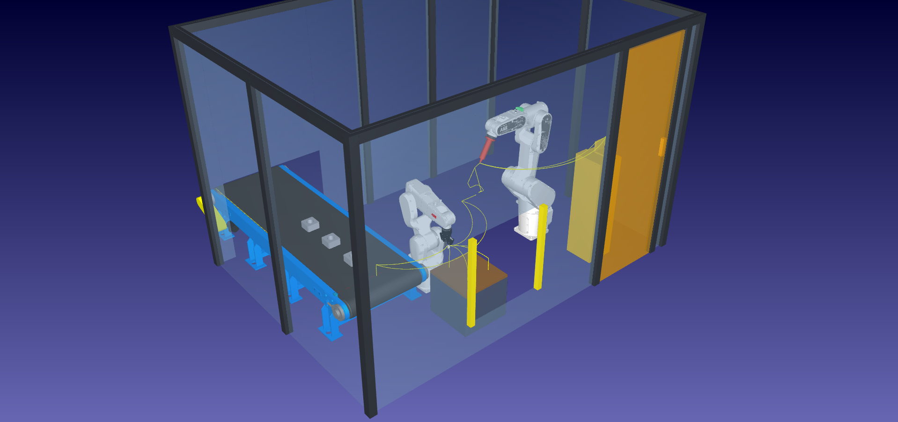
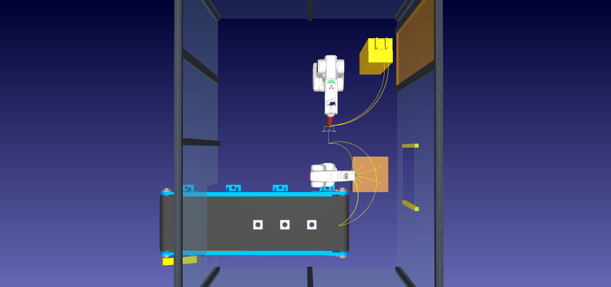
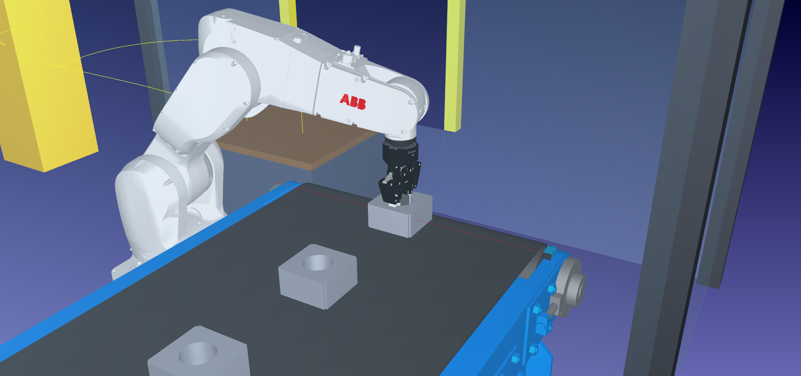
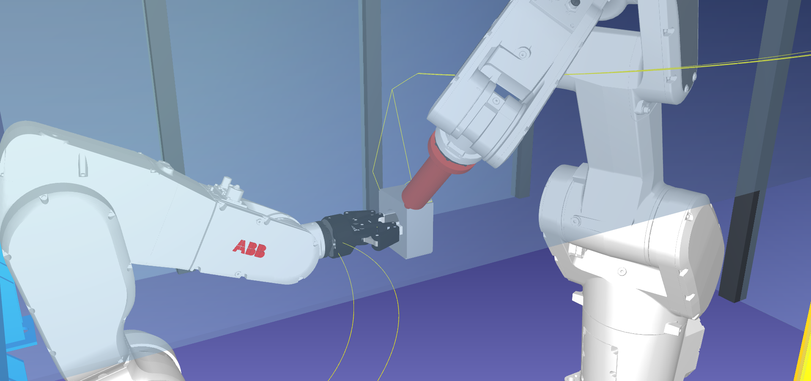
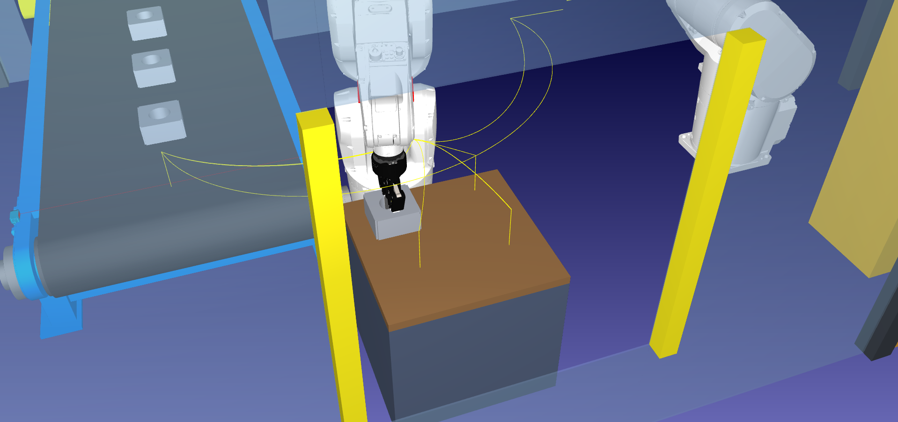
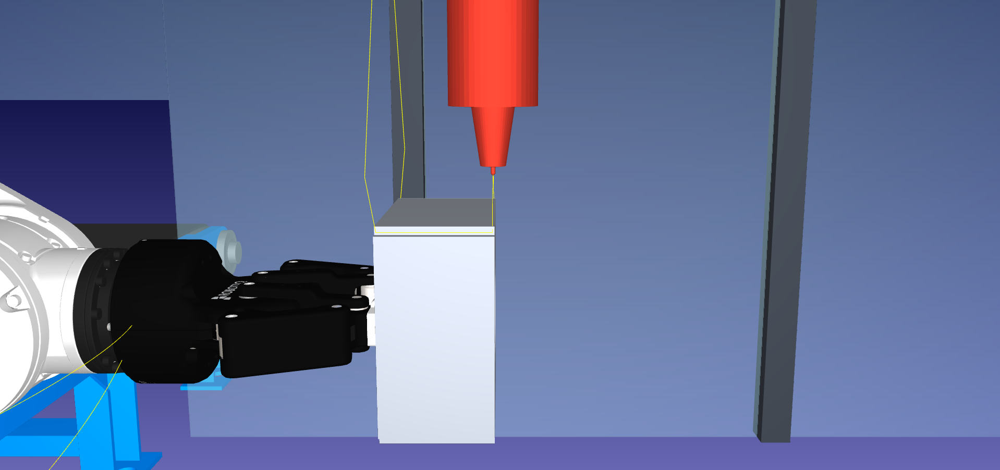
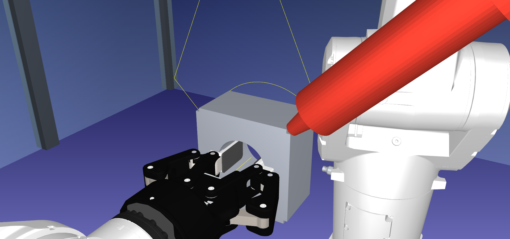
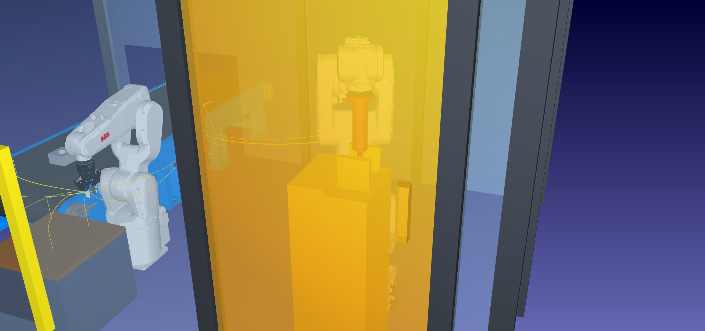

<div align="center">

**UNIVERSIDAD TECNOLÓGICA NACIONAL**<br>
**Facultad Regional Córdoba**<br>
Licenciatura en Automatización y Control

---

**Cátedra: Robótica Industrial**<br>
Trabajo final: celda robotizada de soldadura

# Definición de la celda

*Celda de soldadura TIG de paquetes de estator*

**Grupo 4**<br>
Casali Emiliano · Ferrero Facundo · Vera Gonzalo

**Docentes**<br>
Ing. Julián Luque · Lic. Sergio Perassi

Comisión 2LA1 · Año 2026

</div>

---

## Índice

- [Prólogo](#prólogo)
- [Historial de versiones](#historial-de-versiones)
- [1. Tarea de la celda](#1-tarea-de-la-celda)
- [2. Punto de partida y mejoras](#2-punto-de-partida-y-mejoras)
- [3. Disposición](#3-disposición)
- [4. Equipos](#4-equipos)
- [5. Sistemas de referencia y TCP](#5-sistemas-de-referencia-y-tcp)
- [6. Secuencia de operación](#6-secuencia-de-operación)
- [7. Estructura de programas](#7-estructura-de-programas)
- [8. Tipos de movimiento](#8-tipos-de-movimiento)
- [9. Señales e interlocks](#9-señales-e-interlocks)
- [10. Seguridad](#10-seguridad)
- [11. Variantes de pieza y de patrón](#11-variantes-de-pieza-y-de-patrón)
- [12. Verificación y resultados](#12-verificación-y-resultados)
- [13. Pendientes](#13-pendientes)
- [14. Archivos y reproducción](#14-archivos-y-reproducción)
- [15. Referencias](#15-referencias)

---

## Prólogo

Este documento define la celda que el grupo construyó en RoboDK y justifica cada decisión de diseño
con los documentos de conceptos ([`b_investigacion/conceptos/`](../../b_investigacion/conceptos/)), el
catálogo de componentes ([`componentesRDK.md`](../../b_investigacion/componentesRDK.md)) y la
bibliografía de la cátedra.

La estación está en [`Celda_Soldadura_Estator_Grupo4_v02.rdk`](../Celda_Soldadura_Estator_Grupo4_v02.rdk).
Se genera de forma reproducible con los scripts de [`scripts/`](../scripts/). Los scripts solo
**construyen** la estación: todos los movimientos del ciclo son instrucciones nativas de RoboDK
(MoveJ, MoveL y MoveC), y ningún script mueve los robots durante la ejecución.

Las medidas de la pieza son **medidas de diseño adoptadas** por el grupo (ver
[`componentesRDK.md`, §6](../../b_investigacion/componentesRDK.md)); si se mide un paquete real, se
reemplazan siguiendo el procedimiento de [`scripts/parametros_celda.py`](../scripts/parametros_celda.py).
Todas las cotas de la celda están en [`scripts/parametros_celda.py`](../scripts/parametros_celda.py),
que es la fuente única de valores.



---

## Historial de versiones

| Versión | Archivo | Cambio principal | Documento |
|---|---|---|---|
| v01 | [`Celda_Soldadura_Estator_Grupo4_v01.rdk`](../Celda_Soldadura_Estator_Grupo4_v01.rdk) | Versión original: posicionador MTD 250, cilindro de 6 cordones, sin transporte | Informe de la entrega anterior (`d_presentacion/`) |
| v02 | [`Celda_Soldadura_Estator_Grupo4_v02.rdk`](../Celda_Soldadura_Estator_Grupo4_v02.rdk) | Manipulador + soldador TIG; paquete de estator real; entrada por cinta y salida por pallet | Este documento |
| v03 | [`Celda_Soldadura_Estator_Grupo4_v03.rdk`](../Celda_Soldadura_Estator_Grupo4_v03.rdk) | **Cinta pasante:** la misma cinta trae y saca las piezas; se elimina el pallet y su ventana | [mejora 01](mejora_01_cinta_pasante.md) |

| v04 | [`Celda_Soldadura_Estator_Grupo4_v04.rdk`](../Celda_Soldadura_Estator_Grupo4_v04.rdk) | **Mantenimiento:** pasillo, cara sur desmontable, accionamiento y equipos afuera, posiciones de mantenimiento | [mejora 02](mejora_02_modos_mantenimiento.md) |
| **v05** | [`Celda_Soldadura_Estator_Grupo4_v05.rdk`](../Celda_Soldadura_Estator_Grupo4_v05.rdk) | **Versión actual.** Coordinador, modos, sensores y panel embebido; `Programa_Principal` sigue siendo el ciclo nativo | [panel y sensores](panel_y_sensores.md) y [manual](manual.md) |

> **v05:** el cordón baja a 5 mm/s, los traslados suben a 1000 mm/s y 150°/s, y el lote pasa a 314 s,
> medido a ×2. Los valores de velocidad y tiempo de este documento corresponden a la v02. Ver
> [panel y sensores](panel_y_sensores.md#paradas-recuperación-y-pedido).

Este documento define la **v02**. En las secciones que cambian con la v03 hay una nota
**"v03"** al final, con el resumen del cambio; el detalle y la justificación están en la [mejora 01](mejora_01_cinta_pasante.md).

---

## 1. Tarea de la celda

La celda **suelda con TIG sin aporte los paquetes de chapa de estator** de un motor universal de
lavarropas de ~330 W. Cada paquete lleva **4 cordones axiales**, uno por arista, que unen las chapas
(ver [`despiece_motor_lavarropas.md`, §4](../../b_investigacion/despiece_motor_lavarropas.md)).

| Dato | Valor |
|---|---|
| Pieza | Paquete de estator 105 × 105 × 55 mm, agujero Ø55, 3,6 kg (medidas adoptadas) |
| Cordones por pieza | 4, de 53 mm, en el escalón de cada arista |
| Proceso | TIG sin aporte, 8 mm/s, distancia de arco 2 mm |
| Entrada | Cinta transportadora, lote de 4 piezas |
| Salida | Pallet de 4 posiciones (2 × 2) |

**Por qué conviene robotizarla:** cumple cinco de las seis condiciones de Groover [Groover, 8.4,
p. 224]:
- trabajo peligroso (radiación UV, alta corriente);
- ciclo repetitivo;
- operación en varios turnos;
- tiradas largas;
- pieza en posición conocida.

Además, el soldador manual solo tiene el arco encendido un 20–30 % del turno [Groover, 8.4.2, p. 220].

## 2. Punto de partida y mejoras

### 2.1 Ejemplo de RoboDK de partida

Se toma como base el ejemplo **17 *Conveyor Swap*** de la biblioteca de RoboDK
(`Conveying-with-ABB-CRB-1300-7-1-4.rdk`). De él se reutilizan:

- la **cinta transportadora** modelada como mecanismo lineal, con las piezas colgadas de un frame
  que avanza con su eje;
- el **sensor láser** de detección de pieza;
- el criterio de mover la cinta con un `MoveJ` a un target del mecanismo, sin Python.

**Qué se agregó:** todo lo demás, con una razón para cada elemento:

| Elemento agregado | Por qué |
|---|---|
| Robot manipulador IRB 1200 con pinza | Tomar la pieza de la cinta, presentarla y girarla frente a la antorcha, y depositarla (§4) |
| Robot soldador CRB 1300 con antorcha TIG | Ejecutar los cordones (§4) |
| Secuencia de soldadura con MoveL y MoveC | Cordones rectos y transición en arco entre aristas (§8) |
| Pallet de 4 posiciones | Salida ordenada y variante de patrón (§11) |
| Estación de servicio de la antorcha | Verificación del TCP y cambio de tungsteno (§10) |
| Cerramiento, puerta, cortina de luz | Seguridad de nivel 1 y 2 (§10) |
| Interlocks entre robots | Sincronización de la presentación y la soldadura (§9) |

### 2.2 Mejoras respecto de la versión anterior del grupo

La estación anterior ([`Celda_Soldadura_Estator_Grupo4_v01.rdk`](../Celda_Soldadura_Estator_Grupo4_v01.rdk))
soldaba 6 cordones en un cilindro montado en un posicionador ABB MTD 250. Se conserva su idea
central: **la pieza gira y el soldador repite el mismo cordón en el mismo lugar del espacio**. Se
corrige lo siguiente:

| Versión anterior | Esta celda |
|---|---|
| Cilindro genérico, 6 cordones cada 60° | Paquete de estator real, 4 cordones en las aristas |
| Posicionador de 250 kg para una pieza de 3,6 kg | Manipulador de 7 kg con pinza |
| Carga y descarga manual, dentro del cerramiento | Entrada por cinta y salida por pallet, desde afuera |
| Antorcha MIG | Antorcha TIG, coherente con el proceso |
| Sin MoveC | MoveC en la transición entre aristas |
| El cordón empezaba con MoveJ | Aproximación y entrada al cordón con MoveL |
| Targets duplicados | Un target por punto, nombres por función |
| El panel Python dirigía la secuencia | El `Programa_Principal` ejecuta el ciclo completo |
| Estación pequeña, sin transporte | Escala real, con transporte de entrada y salida |

## 3. Disposición



Cotas en el sistema `Frame_Celda` (origen en el piso, bajo la base del manipulador):

| Elemento | Posición [mm] | Observación |
|---|---|---|
| Robot manipulador IRB 1200 | (0, 0, 0) | En el centro de la celda |
| Robot soldador CRB 1300 | (0, 1150, 0), girado −90° | Enfrentado al manipulador |
| Zona de soldadura (centro de la pieza presentada) | (0, 500, 620) | Entre los dos robots |
| Toma en la cinta | (120, −560, 366,5) | A 250 mm del final de la banda |
| Pallet de salida (centro) | (480, 0, 370) | Sobre un soporte de 350 mm |
| Estación de servicio | (520, 1300, 0) | Frente a la puerta |
| Cerramiento | X ∈ [−1300, 850], Y ∈ [−1150, 1850], 2000 mm de alto | 2,15 × 3,0 m |

**Justificación:**

- **Robot en el centro** [Barrientos, 9.1.1, p. 258]: el manipulador queda rodeado por la cinta, la
  zona de soldadura y el pallet, y aprovecha todo su campo de acción. Es la disposición típica de la
  soldadura al arco.
- **Alcance:** el IRB 1200 tiene 703 mm. La toma queda a ~570 mm de su base, la zona de soldadura a
  500 mm y el pallet a 380–580 mm. Ver la verificación de alcance en §12.
- **Soldador enfrentado:** el CRB 1300 trabaja desde arriba sobre las aristas superiores de la pieza
  presentada, con 1150 mm de alcance holgado. Así, los dos robots no comparten el volumen de giro
  de la pieza (§8.3).
- **Cinta y pallet atraviesan el cerramiento:** el operario carga la cinta y retira el pallet desde
  afuera, que es la medida de "dispositivos de intercambio de piezas" de Barrientos [Barrientos,
  9.3.2, p. 274] y el esquema de doble estación de Groover [Groover, 8.4.2, p. 220].

> **v03:** la toma pasa a x = −150 mm y el depósito a x = +150 mm, los dos sobre la banda. Se
> quitan el pallet y su soporte, y la cinta se prolonga con un tramo de salida que atraviesa la
> cara este del cerramiento (abertura de salida en lugar de la ventana del pallet). Ver la
> [mejora 01](mejora_01_cinta_pasante.md), §3 y §4.

## 4. Equipos

El detalle de cada componente está en [`componentesRDK.md`](../../b_investigacion/componentesRDK.md).

| Equipo | Función | Justificación resumida |
|---|---|---|
| **ABB IRB 1200-7/0.7** + pinza **Robotiq 2F-85** | Toma, presenta, gira y deposita la pieza | 7 kg ≥ 4,5 kg (pieza + pinza). J6 de ±360° gira la pieza sobre su eje. Agarre interior en el agujero: deja libres las 4 aristas |
| **ABB CRB 1300-10/1.15** + **antorcha TIG** | Suelda los cordones | 6 GDL, trayectoria continua, carga baja y repetibilidad de 0,023 mm, como pide la soldadura al arco [Barrientos, 9.2; Groover, 8.4.2] |
| **Cinta ConveyorA** + **sensor láser** | Entrada de piezas | Mecanismo lineal sin Python (requisito C3); el sensor confirma la pieza en la toma |
| **Pallet de 4 posiciones** sobre soporte | Salida | Variante de patrón (requisito C3) |
| **Estación de servicio** | Verificación de TCP y cambio de tungsteno | El TCP de una antorcha TIG cambia con el desgaste del tungsteno |
| **Cerramiento**, **puerta**, **cortina de luz** | Seguridad | Niveles 1 y 2 de protección [Clase 2] |

**Por qué un manipulador en lugar de un posicionador:** el posicionador solo gira la pieza. El
manipulador además la toma de la cinta y la deposita en el pallet, con lo que el operario no entra
a la celda para cargar y descargar. Un posicionador puede reemplazar grados de libertad del robot
[Barrientos, 9.2.2, p. 265], pero acá el robot manipulador hace las dos funciones.

> **v03:** el pallet sale de la celda; la salida es la misma **cinta pasante** (modelo ConveyorA +
> tramo de salida propio) con una **cortina de luz en la entrada y otra en la salida**.

## 5. Sistemas de referencia y TCP

Requisito C1 [Lineamientos]. Conceptos en [04](../../b_investigacion/conceptos/04_sistemas_de_referencia_y_tcp.md).

### 5.1 Frames propios

| Frame | Ubicación | Para qué sirve |
|---|---|---|
| `Frame_Celda` | Piso, bajo la base del manipulador | Referencia de toda la celda (*World*) |
| `Frame_Soldadura` | Centro de la pieza presentada, ejes alineados con la celda; el eje de la pieza en +Y | Todos los targets de soldadura y de presentación. Si se corre la zona de soldadura, se mueve un solo frame |
| `Frame_Toma_Cinta` | Centro de la cara inferior de la pieza en la toma | Targets de toma |
| `Frame_Banda` | Solidario al eje de la cinta | Las piezas avanzan con la banda |
| `Frame_Pallet` | Centro de la cara superior del pallet | Las 4 posiciones de depósito |
| `Frame_Servicio` | Base de la estación de servicio | Verificación de TCP y cambio de tungsteno |

**Ventaja del frame de soldadura:** los cordones se definen respecto de la pieza y no de la base
del robot. Como el manipulador presenta siempre la pieza en el mismo lugar, el mismo programa de
soldadura sirve para los dos lados de la pieza y para todas las piezas.

### 5.2 Herramientas y TCP

| Herramienta | TCP respecto de la brida | Justificación |
|---|---|---|
| `Antorcha_TIG` (CRB 1300) | X = 0, Y = 0, Z = 207 mm; Z a lo largo del electrodo | Punta del tungsteno: el punto desde el que se establece el arco. La orientación del target expresa el ángulo de la antorcha |
| `TCP_Pinza` (IRB 1200) | X = 0, Y = 0, Z = 150 mm; Z a lo largo de la pinza | Centro de las almohadillas de los dedos. Con el TCP a 20 mm dentro del agujero, la pieza queda tomada a media altura de los dedos |

El modelo de la pinza es un mecanismo sin TCP; `TCP_Pinza` se definió como herramienta propia. El
largo se midió sobre el modelo: las puntas de los dedos quedan a ~160 mm de la brida.

> **v03:** se agrega `Frame_Deposito_Cinta` (punto de depósito sobre la banda). `Frame_Pallet` se
> reutiliza como `Frame_Piezas_Soldadas`, colgado de `Frame_Banda`: las piezas soltadas avanzan
> con la cinta.

## 6. Secuencia de operación

### 6.1 Ciclo de una pieza

| Paso | Robot | Qué hace |
|---|---|---|
| 1 | Cinta | Avanza un paso (300 mm) y lleva el estator siguiente a la toma. Señal `PIEZA_EN_TOMA` |
| 2 | Manipulador | Toma la pieza con agarre interior y la levanta |
| 3 | Manipulador | La presenta en la zona de soldadura con su eje hacia el soldador (aristas A y B arriba). Señal `PIEZA_PRESENTADA` |
| 4 | Soldador | Cordón A → transición en arco → cordón B. Vuelve a su reposo. Señal `SOLDADURA_TERMINADA` |
| 5 | Manipulador | Gira la pieza 180° con J6 (aristas C y D arriba) |
| 6 | Soldador | Cordón C → transición → cordón D (el mismo programa del paso 4) |
| 7 | Manipulador | Sale de la zona de soldadura y deposita la pieza en la posición k del pallet |
| 8 | Manipulador | Vuelve al reposo |

| Toma en la cinta | Cordón A | Depósito en el pallet |
|---|---|---|
|  |  |  |

### 6.2 Lote

Un **lote** son 4 piezas: las que caben en el pallet. Al completarlo, `Fin_Lote` hace la
**verificación del TCP** en la estación de servicio y vuelve la cinta al origen. El cambio de pallet
es una parada natural del proceso, y por eso ahí se verifica la antorcha.

El **cambio de tungsteno** (`Sold_Cambio_Tungsteno`) se ejecuta a pedido: el robot lleva la
antorcha a la bandeja de servicio, la celda se pausa para el operario y, al reanudar, se verifica
el TCP.

> **v03:** en el paso 7 el manipulador devuelve la pieza soldada a la banda, un paso aguas abajo
> de la toma. El avance de la cinta del ciclo siguiente la corre hacia la salida y libera el
> depósito. Al final del lote, `Cinta_Evacuar` saca las 4 piezas soldadas fuera de la celda.

## 7. Estructura de programas

Requisito C2 [Lineamientos]. Conceptos en [06](../../b_investigacion/conceptos/06_estructura_de_programas_y_senales.md).

```text
Programa_Principal
├── Inicio_Celda                 señales en 0, robots a reposo, pinza abierta
├── Ciclo_Pieza_1 … Ciclo_Pieza_4
│   ├── Cinta_Avanzar_k          cinta a la posición k, PIEZA_EN_TOMA = 1
│   ├── Man_Tomar_Cinta          espera PIEZA_EN_TOMA, entra, sujeta, sale
│   │   ├── Pinza_Cerrar
│   │   ├── Pinza_Sujetar
│   │   └── Evento_Tomar_Pieza   adjunta el estator a TCP_Pinza
│   ├── Man_Presentar_Lado1      reorienta y presenta, PIEZA_PRESENTADA = 1
│   ├── Sold_Par_Cordones        espera PIEZA_PRESENTADA; cordones A y B
│   │   └── Sold_Ir_Reposo
│   ├── Man_Presentar_Lado2      espera SOLDADURA_TERMINADA; gira 180° con J6
│   ├── Sold_Par_Cordones        cordones C y D (el mismo programa)
│   ├── Man_Depositar_Pk         espera SOLDADURA_TERMINADA; deposita en la posición k
│   │   ├── Pinza_Cerrar
│   │   └── Evento_Soltar_Pieza  deja el estator en Frame_Pallet
│   └── Man_Ir_Reposo
└── Fin_Lote
    ├── Sold_Servicio_Antorcha   verificación del TCP
    └── Cinta_Reinicio_Lote

Sold_Cambio_Tungsteno            a pedido: pausa para el operario + Sold_Servicio_Antorcha
```

**Criterios:**

- **Una función por programa**, con nombre verbo + objeto y un prefijo por equipo (`Man_`,
  `Sold_`, `Cinta_`, `Pinza_`).
- **Reutilización:** `Sold_Par_Cordones` se escribe una vez y se llama dos veces por pieza, porque
  el manipulador presenta siempre las aristas en el mismo lugar. `Man_Tomar_Cinta` sirve para todas
  las piezas porque la cinta las trae siempre a la misma toma.
- **Estado inicial y final conocidos:** cada programa del soldador termina en su reposo; cada
  depósito, sobre el pallet sin la pieza. El estado final del lote coincide con el inicial, así que
  el ciclo puede repetirse (requisito C4).
- **Comentarios:** cada programa empieza con una instrucción de comentario que dice qué hace, y los
  pasos importantes están comentados.

> **v03:** `Man_Depositar_P1…P4` se reemplazan por un único `Man_Depositar_Cinta`. `Fin_Lote`
> llama a `Sold_Servicio_Antorcha` y a `Cinta_Evacuar` (nuevo); `Cinta_Reinicio_Lote` se elimina.

## 8. Tipos de movimiento

Conceptos en [05](../../b_investigacion/conceptos/05_tipos_de_movimiento.md).

### 8.1 Criterio aplicado

| Tipo | Dónde se usa | Por qué |
|---|---|---|
| **MoveJ** | Traslados entre zonas: reposo ↔ toma, toma → presentación (con reorientación de vertical a horizontal), zona de soldadura → pallet, reposo del soldador ↔ zona; giro de 180° de la pieza; mecanismos (cinta y pinza) | No importa la trayectoria de la herramienta. Es el movimiento más rápido y no tiene los problemas de las trayectorias cartesianas [Craig, 7.5, p. 222] |
| **MoveL** | Entrada y salida vertical en el agujero de la pieza; entrada recta a la presentación y salida de la zona de soldadura; bajada al pallet; aproximación y retiro radial de la antorcha; **los 4 cordones**; bajada a la verificación del TCP | La herramienta tiene que seguir una recta: para no rozar la pieza, para entrar y salir sin arrastrarse y para que el cordón siga la arista |
| **MoveC** | **Transición entre los cordones A y B (y C y D)** | La antorcha tiene que rodear la pieza a distancia constante (§8.2) |

### 8.2 La transición en arco (MoveC)

Después del cordón A, la antorcha tiene que pasar a la arista B, que está a 90° sobre el eje de la
pieza. La transición tiene tres tramos:

1. **Separación radial (MoveL)** desde el fin del cordón A hasta `Sold_A_Salida`, a 80 mm del eje.
2. **Arco con centro en el eje del estator (MoveC)**, de radio **R_TRANSICION = 80 mm**, pasando por
   `Sold_Transicion_Medio` (sobre la vertical de la cara superior) hasta `Sold_B_Entrada`.
3. **Entrada radial (MoveL)** hasta el inicio del cordón B.

- **Por qué 80 mm y no el radio de soldadura:** durante el cordón el TCP está a 70,6 mm del eje
  (48,5 · √2 + 2). Los bordes del escalón de la arista están a √(48,5² + 52,5²) = **71,5 mm**. Un arco
  al radio de soldadura roza la pared del escalón al salir de la arista. Así lo detectó la simulación
  con la pieza real enganchada en la pinza.
- **Orientación:** la antorcha se mantiene radial y gira 90° a lo largo del arco.
- **Holgura:** en el punto medio, la punta queda a 80 − 52,5 = **27,5 mm** de la cara superior.

| Transición en arco |
|---|
|  |

**Por qué un arco y no otro movimiento:**
- Con un MoveL directo de A a B, la antorcha atravesaría la esquina de la pieza.
- Con un retiro, un MoveJ y otra aproximación, se agregan dos movimientos y la orientación queda
  sin control.
- El arco mantiene la distancia y la orientación respecto de la pieza durante todo el cambio de
  arista. Además, los cordones se recorren en sentidos opuestos (A en +Y, B en −Y), así que la
  transición se hace siempre en la cara libre de la pieza, lejos de la pinza.

El arco se recorre con el **arco apagado**: es un movimiento de la herramienta, no un cordón.

### 8.3 Detalle de un par de cordones



| # | Instrucción | Velocidad | Arco |
|---|---|---|---|
| 1 | MoveJ `Sold_Zona_Aprox` (250 mm sobre la pieza) | 500 mm/s, redondeo 5 mm | — |
| 2 | MoveL `Sold_A_Aprox` (40 mm afuera, radial) | 100 mm/s | — |
| 3 | MoveL `Sold_A_Inicio` | 100 mm/s | — |
| 4 | MoveL `Sold_A_Fin` (53 mm en +Y) | **8 mm/s** | **ON** |
| 5 | MoveL `Sold_A_Salida` (separación radial hasta R = 80 mm) | 100 mm/s | — |
| 6 | MoveC `Sold_Transicion_Medio` → `Sold_B_Entrada` (R = 80 mm) | 100 mm/s | — |
| 7 | MoveL `Sold_B_Inicio` (entrada radial) | 100 mm/s | — |
| 8 | MoveL `Sold_B_Fin` (53 mm en −Y) | **8 mm/s** | **ON** |
| 9 | MoveL `Sold_B_Retiro` (40 mm afuera, radial) | 100 mm/s | — |
| 10 | MoveL `Sold_Zona_Aprox` | 100 mm/s | — |
| 11 | Llamada a `Sold_Ir_Reposo` (MoveJ) | 500 mm/s | — |

- **Precisión:** en los puntos de soldadura el redondeo es nulo, para llegar exactamente al inicio y
  al fin de cada cordón. En los traslados se usan 5 mm, para ganar continuidad
  [Barrientos, 8.2.5, pp. 229–230].
- **Por qué el soldador vuelve al reposo:** antes de que el manipulador gire la pieza, el soldador
  sale de su volumen de giro.

## 9. Señales e interlocks

Conceptos en [06](../../b_investigacion/conceptos/06_estructura_de_programas_y_senales.md).

| Señal | La activa | La espera | Significado |
|---|---|---|---|
| `PIEZA_EN_TOMA` | `Cinta_Avanzar_k` (sensor láser) | `Man_Tomar_Cinta` | Hay un estator en la toma |
| `PIEZA_PRESENTADA` | `Man_Presentar_Lado1/2` | `Sold_Par_Cordones` | El manipulador terminó de presentar; el soldador puede entrar |
| `SOLDADURA_TERMINADA` | `Sold_Par_Cordones` | `Man_Presentar_Lado2`, `Man_Depositar_Pk` | El soldador salió de la zona; el manipulador puede girar o retirar la pieza |
| `ARCO_TIG` | `Sold_Par_Cordones` | — (salida a la fuente de soldadura) | Arco encendido solo durante los cordones |

Corresponden a los interlocks WAIT y SIGNAL de Groover [Groover, 8.5, pp. 231–232]. En la
simulación el programa principal ejecuta los pasos en orden, así que las esperas se cumplen en
cuanto llegan; en una celda real cada robot tendría su propio programa y las señales los
sincronizarían.

## 10. Seguridad

Conceptos en [07](../../b_investigacion/conceptos/07_seguridad_y_normativa.md).

| Medida | Nivel [Clase 2] | Implementación en la celda | Base |
|---|---|---|---|
| Cerramiento perimetral de 2 m | 1 | Paneles translúcidos sobre estructura de postes | Barreras de acceso [Barrientos, 9.3.2, p. 274] |
| Puerta con enclavamiento | 1 | Puerta en la cara este, frente a la estación de servicio. Abrirla detiene la celda | Puertas con interlock [Clase 2] |
| Carga y descarga desde afuera | 1 | La cinta entra por un túnel; el pallet se retira por una ventana | Dispositivos de intercambio de piezas [Barrientos, 9.3.2, p. 274] |
| Cortina de luz en la ventana del pallet | 2 | Emisor y receptor verticales. Cortar el haz detiene el robot | Cortinas en ventanas de carga [Clase 2] |
| Protección contra el arco | — | Paneles del cerramiento (ISO 25980, como referencia) | Riesgos del arco [Groover, 8.4.2] |
| Posición y procedimiento de servicio | — | Cambio de tungsteno con la celda detenida, en un punto accesible desde la puerta | El 90 % de los accidentes ocurre en mantenimiento, ajuste o programación [Barrientos, 9.3.2, p. 272] |
| Verificación del TCP | — | Al final de cada lote y después de cada cambio de tungsteno | Calidad del cordón y detección de errores [Groover, 14.2.1] |
| Robot colaborativo | 3 | **No se usa**: el arco abierto no permite compartir el espacio | [Clase 2] |

**Responsabilidades:** la seguridad intrínseca de los robots es del fabricante. El diseño de la
celda, su programación y su uso son del integrador, es decir, del grupo [Barrientos, 9.3.2, p. 273].

**Normas de referencia** (no consultadas): ISO 10218-2 (celdas robotizadas), ISO 10218-1 e ISO 12100.

| Estación de servicio y puerta |
|---|
|  |

> **v03:** desaparecen la ventana del pallet y su cortina. La cinta atraviesa el cerramiento por
> dos túneles (oeste y este), cada uno con su cortina de luz. **El operario no entra a la celda en
> operación normal**: carga y descarga afuera.

## 11. Variantes de pieza y de patrón

Requisito C3 [Lineamientos]: la celda tiene **los tres elementos** que se piden como alternativas.

| Elemento | Cómo está | Justificación |
|---|---|---|
| **Segundo robot** | El manipulador IRB 1200 trabaja junto al soldador CRB 1300, sincronizados por interlocks | Reemplaza al posicionador y agrega el transporte de la pieza (§2.2) |
| **Cinta transportadora** | Mecanismo lineal movido con `MoveJ` a targets articulares, sin Python | Entrada de piezas desde afuera de la celda |
| **Patrón de pallet** | 4 posiciones (2 × 2) con un programa de depósito por posición | Salida ordenada; el lote coincide con un pallet |

> **v03:** se elimina el patrón de pallet a propósito; C3 se cumple con la cinta y el segundo robot.

## 12. Verificación y resultados

Verificación hecha de dos formas:

- con [`scripts/verificar_celda.py`](../scripts/verificar_celda.py): detección de colisiones activa,
  muestreo de la trayectoria cada 1 mm y 1°, y una pieza de prueba colgada de la pinza;
- ejecutando `Ciclo_Pieza_1` en la simulación con los eventos de tomar y soltar cargados: el
  estator 1 pasa de `Frame_Banda` a `TCP_Pinza` y termina en `Frame_Pallet`, sin colisiones.

Con el muestreo por defecto del `Update` (más grueso) no se detectaba un roce de la punta con el
escalón de la arista en la transición; lo detectó la ejecución con la pieza real y llevó a la
separación radial de §8.2.

### 12.1 Alcance

**Los 23 targets cartesianos son alcanzables**, con la herramienta de cada robot. Los targets
articulares (reposos, giro de la pieza, pinza y cinta) son alcanzables por definición.

### 12.2 Colisiones

`Programa_Principal` se recorre completo **sin colisiones**, también con la pieza transportada.

Solo se desactivaron los contactos que existen por diseño:

| Par desactivado | Por qué |
|---|---|
| Pinza ↔ brida del IRB 1200; antorcha ↔ brida del CRB 1300 | Están montadas sobre la brida |
| Eslabones de la pinza entre sí | Es un mecanismo articulado |
| Estator ↔ banda, estator ↔ pallet | La pieza apoya sobre ellos |
| Estator ↔ dedos de la pinza | Los dedos entran en el agujero para tomarla |
| Sensor láser ↔ todo | El modelo incluye el haz de luz como geometría |

Quedan verificados, entre otros: los robots entre sí; la antorcha con la pieza (a 2 mm del cordón y
a 27,5 mm de la cara en la transición); la pieza transportada con el cerramiento, el soporte del
pallet y la estación de servicio.

### 12.3 Tiempo de ciclo

Medido ejecutando la simulación a 10× y escalando el tiempo. El `Update` de RoboDK no tiene en
cuenta los cambios de velocidad dentro del programa (estima 1,4 s para un tramo que dura 6,7 s a
8 mm/s), así que no sirve para el tiempo de ciclo.

| Etapa | Tiempo [s] |
|---|---|
| Avance de la cinta (1 paso) | ~4 |
| `Man_Tomar_Cinta` | 9,0 |
| `Man_Presentar_Lado1` | 5,8 |
| `Sold_Par_Cordones` (A y B) | 22,0 |
| `Man_Presentar_Lado2` (giro) | 4,2 |
| `Sold_Par_Cordones` (C y D) | 22,4 |
| `Man_Depositar_Pk` | 10,7 |
| `Man_Ir_Reposo` | 3,4 |
| **Ciclo de una pieza (`Ciclo_Pieza_2`)** | **75,7** |
| `Fin_Lote` (verificación de TCP + cinta al origen) | 12,7 |
| **Lote de 4 piezas (`Programa_Principal`)** | **321,4** |

Descomposición según Groover, Tc = To + Th + Tt [Groover, 8.4, p. 224], por pieza y con el lote
prorrateado:

| Término | Valor | Contenido |
|---|---|---|
| To (operación) | 26,5 s | 4 cordones × 53 mm / 8 mm/s, arco encendido |
| Tt (herramienta) | ~18 s | Aproximaciones, transiciones, retiros y reposos del soldador |
| Th (pieza) | ~36 s | Cinta, toma, presentación, giro, depósito |
| **Tc** | **80,4 s** | 321,4 s / 4 piezas |
| **Tasa de ciclo Rc = 3600 / Tc** | **≈ 45 piezas/h** | |
| **To / Tc** | **≈ 33 %** | Comparable con el 20–30 % de arco encendido de un soldador manual [Groover, 8.4.2, p. 220], pero sostenido en todos los turnos |

**Dónde se podría mejorar:** el soldador está quieto mientras el manipulador toma y deposita (Th).
Con dos manipuladores, o con un segundo puesto de presentación, el soldador podría trabajar mientras
se carga la pieza siguiente. Es la idea de los dos utillajes de Groover [Groover, 8.4.2, p. 220].
Queda fuera del alcance de este trabajo.

> **v03:** verificada sin colisiones, también ejecutando el `Programa_Principal` con los eventos:
> las 4 piezas salen de la celda y, con la reposición del lote, el programa se repite en bucle.
> Ciclo de 73,6 a 75,2 s por pieza, lote de ≈ 315 s (≈ 45 piezas/h), igual que la v02.

## 13. Pendientes

1. **Eventos de simulación (tomar y soltar la pieza).** ✔ Cargados. La API de RoboDK no permite
   crear estos eventos, así que se cargaron desde la interfaz. Cada uno está en un subprograma propio, que llaman
   la toma y los cuatro depósitos, así que alcanza con cargarlos **una sola vez**:
   - en `Evento_Tomar_Pieza`: **adjuntar objeto** a `TCP_Pinza`;
   - en `Evento_Soltar_Pieza`: **desacoplar objeto** de `TCP_Pinza`, con destino `Frame_Pallet`.

   En cada uno se selecciona la instrucción `EVENTO: …`, se agrega el evento desde el menú
   *Programa* y se borra el comentario.
2. **Reposición del lote.** En `Fin_Lote`, las 4 piezas del pallet tienen que volver a la cinta para
   que el ciclo se repita en bucle. Representa la tarea del operario que retira el pallet y carga la
   cinta. Hay dos opciones:
   - eventos de simulación, si RoboDK permite reubicar objetos;
   - un script que solo reubique las piezas, sin mover ningún robot ni mecanismo.

   **Conviene consultar a la cátedra** si la segunda opción es aceptable, porque los lineamientos
   limitan Python a los sensores.
3. **Ejecución en bucle** del `Programa_Principal`, una vez resuelta la reposición del lote.
4. ✔ **Medidas del paquete de estator:** se adoptan las de diseño (105 × 105 × 55 mm). Si se mide un
   paquete real, se actualizan con el procedimiento documentado en `parametros_celda.py`.
5. **Panel de operador y sensores** (puerta, emergencia, presencia), retomando el de la versión
   anterior. Solo puede habilitar o detener el ciclo, nunca mover los robots.
6. **Volver a verificar** con `verificar_celda.py --colisiones --con-pieza` después de los cambios.

> **v03:** la reposición del lote está resuelta con eventos nativos al final de `Fin_Lote`:
> *Ajustar las articulaciones al inicio* (cinta) y *Fijar la posición del objeto (relativa)* (los
> 4 estatores). El `Programa_Principal` se verificó en bucle, con dos lotes seguidos sin
> colisiones y volviendo al estado inicial.

## 14. Archivos y reproducción

| Archivo | Contenido |
|---|---|
| `Celda_Soldadura_Estator_Grupo4_v01.rdk` | Versión anterior del grupo (posicionador MTD 250) |
| `Celda_Soldadura_Estator_Grupo4_v02.rdk` | Estación descripta en este documento (salida por pallet) |
| `scripts/parametros_celda.py` | Todas las cotas y parámetros de proceso |
| `scripts/generar_modelos.py` | Genera los STL propios (pieza, pallet, soporte, antorcha, estación de servicio, cerramiento, puerta, cortina) |
| `scripts/construir_celda.py` | Arma la estación: equipos, frames, herramientas, targets, programas y pares de colisión |
| `scripts/programa_soldadura.py` | Geometría y programa del par de cordones (compartido) |
| `scripts/actualizar_soldadura.py` | Rehace solo la soldadura en una estación existente, sin perder los eventos |
| `scripts/verificar_celda.py` | Verifica alcance, programas y colisiones (con pieza de prueba opcional) |
| `modelos/` | STL propios |
| `modelos/biblioteca/` | Modelos tomados de la biblioteca de RoboDK |
| `imagenes/` | Capturas de este documento |

Para regenerar la estación, con RoboDK abierto:

```text
python scripts/generar_modelos.py
C:\RoboDK\Python-Embedded\python.exe scripts/construir_celda.py
C:\RoboDK\Python-Embedded\python.exe scripts/verificar_celda.py --colisiones --con-pieza
```

`construir_celda.py` borra y rehace la estación, así que los eventos de simulación agregados a mano
(§13) se pierden si se vuelve a ejecutar. Para cambiar la soldadura en una estación que ya tiene
los eventos se usa `scripts/actualizar_soldadura.py`, que solo rehace `Sold_Par_Cordones` y sus
targets; con `--reiniciar-lote` deja además la simulación en el inicio de lote. La estación queda con la velocidad de simulación en 1×
(tiempo real), para que la ejecución se vea con los tiempos de §12.3.

> **v03:** se genera con `scripts/mejora_01_cinta_pasante.py` a partir de la v02, para conservar
> los eventos de tomar y soltar. No se reconstruye con `construir_celda.py`.

## 15. Referencias

- **[Lineamientos]** Cátedra de Robótica, UTN FRC. *Trabajo de fin de curso*, 2026.
- **[Barrientos]** Barrientos, A.; Peñín, L. F.; Balaguer, C.; Aracil, R. *Fundamentos de Robótica*.
  McGraw-Hill, 1.ª ed. Secciones 8.2, 9.1, 9.2, 9.3 y 10.2.2.
- **[Groover]** Groover, M. P. *Automation, Production Systems, and Computer-Integrated
  Manufacturing*, 4.ª ed. Pearson, 2015. Secciones 8.2, 8.4, 8.5 y 14.2.
- **[Craig]** Craig, J. J. *Robótica*, 3.ª ed. Pearson Educación. Secciones 3.8 y 7.5; capítulo 13.
- **[Clase 1]** Perassi, S. *Robótica Industrial – Clase 1*. UTN FRC, 2026.
- **[Clase 2]** Luque, J. *Islas robotizadas y seguridad industrial*. UTN FRC, 2026.
- RoboDK. Ejemplo 17 *Conveyor Swap* y ejemplo 06 *Pick and Place*. Biblioteca de RoboDK v6.1.1.
- Grupo 4. Documentos de conceptos [00 a 08](../../b_investigacion/conceptos/00_requisitos_y_trazabilidad.md),
  [`componentesRDK.md`](../../b_investigacion/componentesRDK.md) y
  [`despiece_motor_lavarropas.md`](../../b_investigacion/despiece_motor_lavarropas.md).
