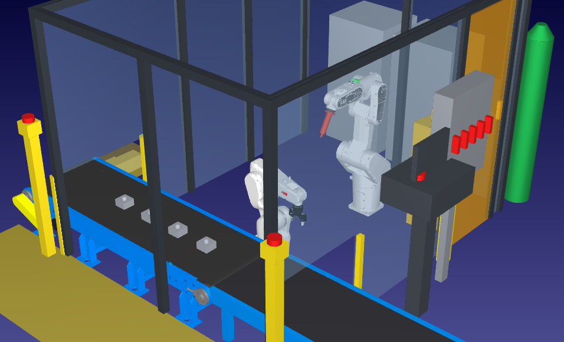
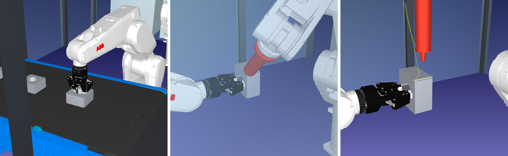
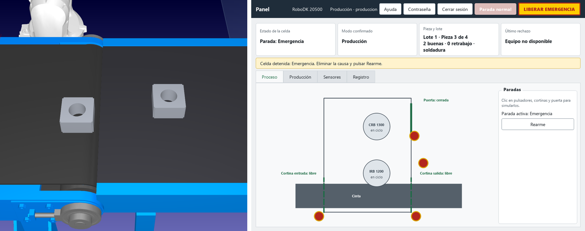

## Prólogo

Este informe describe una celda simulada en RoboDK 6.1.1 que suelda paquetes de chapa de estator con dos
robots ABB. Sigue los contenidos pedidos en los lineamientos de la cátedra: tarea, ejemplo de partida,
equipos y frames, programas y movimientos, resultados, conclusiones y dificultades.

## 1. Tarea de la celda

La celda suelda con **TIG sin aporte** los paquetes de chapa de estator de un motor universal de
lavarropas de unos 330 W. El paquete mide 105 × 105 × 55 mm, tiene un agujero central de 55 mm y pesa
3,6 kg. Lleva **cuatro cordones axiales de 53 mm**, uno por arista, que mantienen unidas las chapas.

La tarea reúne las condiciones que justifican un robot: trabajo peligroso por la
radiación y la corriente del arco, ciclo repetitivo, pieza en posición conocida y tiradas largas. Además,
un soldador manual tiene el arco encendido solo entre el 20 y el 30 % del turno.

El ciclo es el siguiente. La cinta trae el estator a la toma y un sensor láser confirma su presencia. El
manipulador lo toma por el agujero, lo presenta frente al soldador y este hace dos cordones. El manipulador
gira la pieza 180°, el soldador hace los otros dos y la pieza vuelve a la misma cinta, que la saca de la celda.

## 2. Punto de partida y complejidad agregada

La celda parte del ejemplo 17 *Conveyor Swap* de la biblioteca de RoboDK. De él se reutilizaron la cinta
modelada como mecanismo lineal, con las piezas colgadas de un frame que avanza con su eje; el sensor láser
de pieza y el criterio de mover la cinta con un MoveJ a un target del mecanismo, sin Python.

Cada elemento agregado responde a una necesidad:

| Elemento agregado | Motivo |
|---|---|
| Manipulador con pinza | Tomar, presentar, girar y devolver la pieza; reemplaza a un posicionador de 250 kg para una pieza de 3,6 kg |
| Soldador con antorcha TIG | Ejecutar los cordones con trayectoria continua |
| Cinta pasante | Una sola cinta trae y saca las piezas, sin pallet ni ventana de descarga |
| Estación de servicio | Verificar el TCP al final de cada lote y cambiar el tungsteno, que se desgasta |
| Cerramiento, puerta y cortinas | Proteger del arco y de los robots; la cara sur es desmontable para sacar la banda |
| Pasillo, aislamiento y posiciones de mantenimiento | Intervenir cada equipo desde afuera y con los robots en una postura conocida |
| Coordinador, modos y panel | Operar la celda: arranque, paradas, recuperación y mantenimiento (§5) |

## 3. Robots, herramientas y frames

**Robots.** El **ABB CRB 1300-10/1.15** suelda: seis grados de libertad, trayectoria continua y baja carga,
lo que pide la soldadura al arco. El
**ABB IRB 1200-7/0.7**, con pinza **Robotiq 2F-85**, manipula: sus 7 kg cubren los 4,5 kg de pieza y pinza,
y su eje 6 de ±360° gira la pieza sobre su eje. El agarre interior, por el agujero, deja libres las cuatro
aristas.

**Herramientas y TCP.**

| Herramienta | TCP respecto de la brida | Justificación |
|---|---|---|
| `Antorcha_TIG` | Z = 207 mm, a lo largo del electrodo | Punta del tungsteno, desde donde se establece el arco a 2 mm de la pieza |
| `TCP_Pinza` | Z = 150 mm, a lo largo de la pinza | Centro de las almohadillas: la pieza se toma con el TCP 20 mm dentro del agujero |

**Frames propios.**

| Frame | Uso |
|---|---|
| `Frame_Celda` | Referencia general de la celda |
| `Frame_Soldadura` | Centro de la pieza presentada: cordones y presentación |
| `Frame_Toma_Cinta` | Toma de la pieza |
| `Frame_Deposito_Cinta` y `Frame_Deposito_Retrabajo` | Depósito normal y de pieza a revisar |
| `Frame_Banda` | Solidario al eje de la cinta: las piezas avanzan con ella |
| `Frame_Servicio` | Verificación del TCP y cambio de tungsteno |

La decisión clave es `Frame_Soldadura`: los cordones se definen respecto de la pieza y no de la base del
robot. Como el manipulador presenta siempre la pieza en el mismo lugar, un mismo programa suelda los dos
lados de todas las piezas.

## 4. Programas y tipos de movimiento

**Estructura.** `Programa_Principal` llama a `Inicio_Celda`, a `Ciclo_Pieza_1` a `4` y a `Fin_Lote`. Cada
ciclo llama a subprogramas con un nombre por tarea:

| Paso | Subprograma | Robot | Función |
|---|---|---|---|
| 1 | `Cinta_Avanzar_k` | Cinta | Trae el estator k a la toma |
| 2 | `Man_Tomar_Cinta` | IRB | Entra al agujero, sujeta y sale |
| 3 | `Man_Presentar_Lado1` | IRB | Lleva la pieza a la zona de soldadura |
| 4 | `Sold_Par_Cordones` | CRB | Suelda dos aristas |
| 5 | `Man_Presentar_Lado2` | IRB | Gira la pieza 180° |
| 6 | `Sold_Par_Cordones` | CRB | Suelda las otras dos aristas |
| 7 | `Man_Depositar_Cinta` | IRB | Devuelve la pieza a la banda |

Los robots se sincronizan con señales de enclavamiento (interlocks):
`PIEZA_EN_TOMA`, `PIEZA_PRESENTADA` y `SOLDADURA_TERMINADA`. `ARCO_TIG` queda encendida solo durante los
cordones. `Fin_Lote` verifica el TCP, evacúa las piezas y repone el lote, con lo que el ciclo se puede
repetir de forma continua.

**Elección de cada movimiento.** Los robots industriales implementan estas interpolaciones, y se eligen según importe o no la trayectoria de la herramienta:

| Tipo | Dónde | Por qué |
|---|---|---|
| **MoveJ** | Traslados entre zonas, giro de 180°, cinta y pinza | La trayectoria no importa y es lo más rápido; evita singularidades en reorientaciones grandes |
| **MoveL** | Entrada al agujero, apoyo en la banda, aproximación y retiro de la antorcha, **los cuatro cordones** | La herramienta debe seguir una recta: rozaría la pieza, o el cordón no sería recto |
| **MoveC** | Transición entre los dos cordones de cada par | La antorcha debe rodear la pieza a distancia y orientación controladas |

**La transición en arco.** Después del primer cordón, la antorcha pasa a la arista siguiente, a 90° sobre el
eje de la pieza. Un MoveL atravesaría la esquina. Un retiro con MoveJ agregaría movimientos y dejaría la
orientación sin control. Se usa entonces una salida radial con MoveL y un **MoveC de radio 80 mm con centro
en el eje del estator**. El radio no es el de soldadura, de 70,6 mm: los bordes del escalón de la arista
están a 71,5 mm, y un arco a ese radio los rozaría. La simulación con la pieza real lo detectó.

**Velocidades.** Cada tramo va a la velocidad que necesita:

| Tramo | Velocidad |
|---|---|
| Cordón | 5 mm/s |
| Último tramo junto a la pieza | 100 mm/s |
| Salidas y rodeos cerca de la pieza | 200 mm/s |
| Acercamiento a la zona de soldadura | 300 mm/s |
| Traslados libres | 1000 mm/s, 150°/s en MoveJ |

No se encontró un valor publicado para TIG sin aporte en paquetes de estator. Los 5 mm/s equivalen a los
300 mm/min de un ejemplo de soldadura de núcleos laminados con aporte, y deben
confirmarse con ensayos. Los traslados se fijaron por criterio del grupo.

**Python.** Ningún movimiento usa Python: robots, pinza y cinta se mueven con instrucciones de RoboDK, y la
cinta es un mecanismo. `Programa_Principal` funciona sin Python.

## 5. Seguridad, modos y panel de operador

**Protección.** El cerramiento con puerta enclavada corresponde al nivel 1 de protección, recomendado para
soldadura, y las cortinas de luz de la entrada y la salida de la cinta, al nivel 2. No se usa
trabajo colaborativo: el arco abierto no permite compartir el espacio. Las normas ISO 10218-2, ISO 13850 e
ISO 14119 se tomaron solo como referencia. El 90 % de los accidentes ocurre en mantenimiento, ajuste o
programación, de ahí el pasillo, el tablero de aislamiento y las posiciones
de mantenimiento.

**Coordinación.** Un programa nativo, `Coordinador_Panel`, repite lotes de forma continua y atiende
solicitudes entre piezas. Maneja seis modos: mantenimiento de cada robot, de ambos, de la cinta, servicio de
antorcha y correctivo sin movimiento. Cada solicitud se acepta o rechaza con una causa, y regresar de un modo
nunca arranca la producción.

**Panel de operador.** Se ejecuta desde la estación. Muestra el estado, permite fijar cuántas piezas buenas
fabricar y simula pulsadores, cortinas y puerta sobre una imagen del proceso. Tiene perfiles de producción,
mantenimiento y administración, con contraseñas protegidas y registro de operaciones.

**Por qué Python en el panel.** Los lineamientos limitan Python al funcionamiento de sensores adicionales, y
el panel va más allá de leer sensores. Se decidió incluirlo como ampliación por tres razones. Primero, RoboDK
no ofrece interfaz de operador con sus instrucciones. Segundo, **el
panel no mueve nada**: calcula sensores y escribe solicitudes, y es el coordinador nativo quien decide y
ejecuta. Tercero, la celda no depende de él: `Programa_Principal` hace el ciclo completo sin Python.

Hay una excepción, que se declara: la parada inmediata. Una señal leída por un programa no interrumpe un
movimiento en curso, y las señales de seguridad deben monitorearse en forma continua. Se ensayaron varios mecanismos, y el único que detuvo todo de inmediato fue la
función `Stop` de RoboDK, llamada desde el panel. Detiene, no mueve. Representa la función: **una emergencia
real es un circuito de seguridad por hardware**.

**Rearme y recuperación.** Son pasos separados. El rearme confirma que la causa desapareció, sin mover nada.
La recuperación la pide mantenimiento: el soldador sale en línea recta, se repite el par de cordones
interrumpido y, si la pieza se cortó al soldar, se deposita 60 mm corrida hacia el borde derecho de la banda,
como **pieza de revisión o retrabajo**, que no cuenta para el objetivo. El lote continúa.

## 6. Resultados

**Tiempo de ciclo.** Medido ejecutando la simulación a ×2, porque a velocidades mayores el tiempo sale
inflado:

| Magnitud | Resultado |
|---|---|
| Tiempo por pieza | 72 s |
| Arco encendido por pieza | 42 s (58 %) |
| Lote de 4 piezas, con verificación de TCP y reposición | 307 s |
| Producción | 47 piezas por hora |

Bajar el cordón de 8 a 5 mm/s agrega 16 s por pieza. El tiempo del lote no empeoró (305 s antes, 307 s
ahora), porque se ordenaron las velocidades y se quitaron viajes a reposo del manipulador.

**Alcance.** Todos los targets son alcanzables con su herramienta: 0 fuera de alcance.

**Colisiones.** Se verificó con detección activa, muestreo de 1 mm y 1°, y una pieza colgada de la pinza:

| Verificación | Resultado |
|---|---|
| `Programa_Principal`, `Ciclo_Pieza_1` y servicio de antorcha | Válidos, sin colisiones |
| Posiciones de mantenimiento, individuales y conjuntas | Sin colisiones |
| Ciclo continuo | Dos lotes seguidos, sin repetir piezas |
| Parada inmediata en cada fase | Recuperación y lote completo |
| Cortes en distintos puntos de la soldadura | Recuperación sin colisiones |
| Pedido de 2 piezas buenas con 1 de retrabajo | Se fabrican 3, se reponen las piezas y los contadores vuelven a cero |

## 7. Conclusiones y dificultades

La celda cumple la tarea con los tres tipos de movimiento, cada uno donde corresponde, y con frames y TCP
propios. El ciclo nativo funciona sin Python. La principal decisión de diseño fue definir la soldadura
respecto de la pieza presentada, lo que permite usar un solo programa para todos los cordones. Separar el
manipulador del soldador resuelve con un solo equipo la carga, el giro y la descarga.

Las dificultades más importantes fueron:

- **Sujetar la pieza sin tapar las aristas.** Los cuatro cordones están en las aristas, así que un agarre
  exterior los bloqueaba. Se resolvió con un agarre interior, por el agujero, y girando la pieza 180° para
  soldar los dos lados.
- **Pasar de una arista a otra.** El primer arco, al radio de soldadura, rozaba el escalón de la arista. Hubo
  que agregar una salida radial y llevar el radio a 80 mm.
- **Coordinar dos robots sobre una misma pieza.** El soldador no puede entrar hasta que la pieza está
  presentada, y el manipulador no puede girarla hasta que el soldador se retira. Se resolvió con señales de
  enclavamiento.
- **Una salida común para las piezas.** La primera versión descargaba en un pallet, con una ventana en el
  cerramiento. Pasar a una cinta pasante simplificó la celda, pero obligó a rediseñar el depósito y el
  reinicio del lote.
- **Hacer posible el mantenimiento.** La primera disposición no permitía sacar la banda ni aislar los equipos
  desde afuera. Hubo que acercar el cerramiento a la cinta, abrir un pasillo y llevar equipos afuera.
- **Retomar una pieza interrumpida.** Una parada puede dejar la antorcha junto a la pieza, y una retirada
  directa la atravesaría. Se agregó una salida recta antes de ir a reposo, y se decidió enviar esa pieza a
  revisión, porque el cordón cortado no asegura la calidad.
- **Equilibrar velocidad y calidad.** Reducir la velocidad del cordón alarga el ciclo, ya que el arco ocupa más
  de la mitad del tiempo. Se compensó acortando los traslados del manipulador.

Quedan como mejoras la detección real en las cortinas, que hoy se simulan, el forzado de sensores y la
confirmación de los parámetros de soldadura con ensayos.

## Referencias

- Barrientos, A.; Peñín, L. F.; Balaguer, C.; Aracil, R. *Fundamentos de Robótica*. McGraw-Hill.
- Groover, M. P. *Automation, Production Systems, and Computer-Integrated Manufacturing*, 4.ª ed. Pearson, 2015.
- Luque, J. *Islas Robotizadas y Seguridad Industrial*. Cátedra de Robótica Industrial, UTN FRC.
- Cátedra de Robótica Industrial. *Trabajo de fin de curso: simulación de una celda robotizada*. UTN FRC, 2026.
- *Method for manufacturing electrical steel sheet laminated core having reduced core loss and increased strength, and laminated core produced by the same*.
- Documentación de RoboDK 6.1: https://robodk.com/doc/en/
- ISO 10218-2, ISO 13850 e ISO 14119, citadas solo como referencia; no se consultó su texto.
