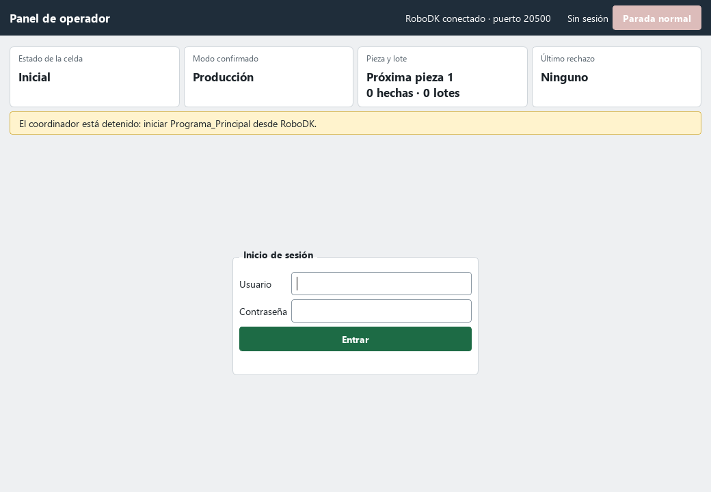
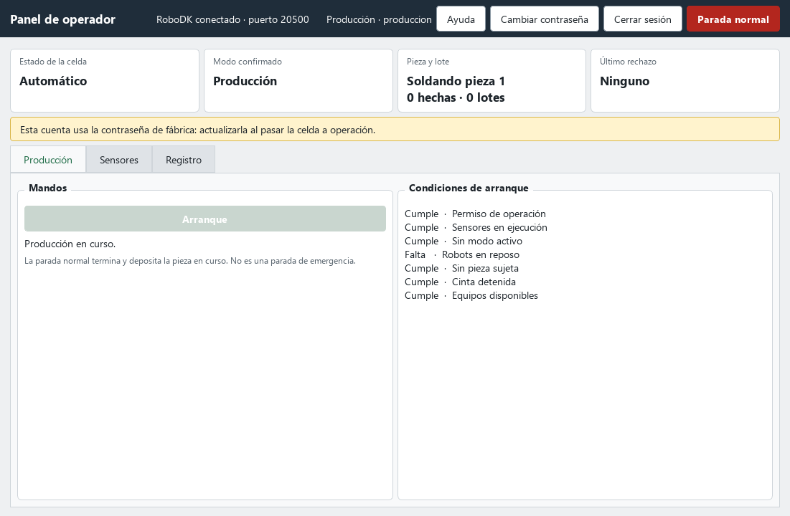
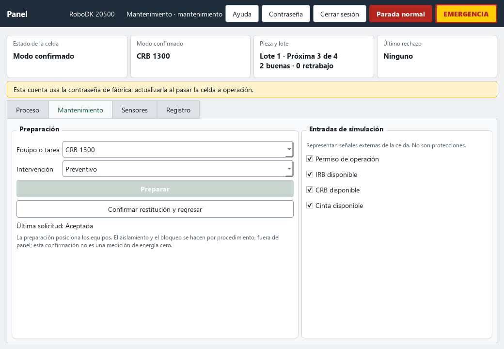
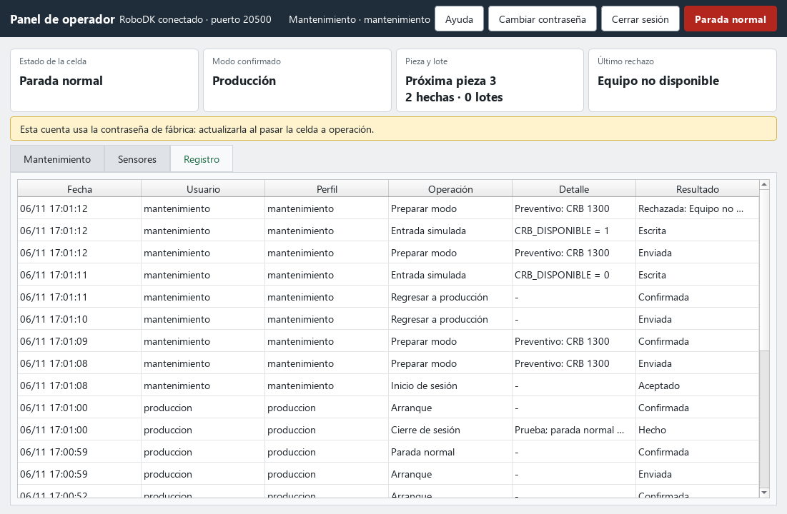
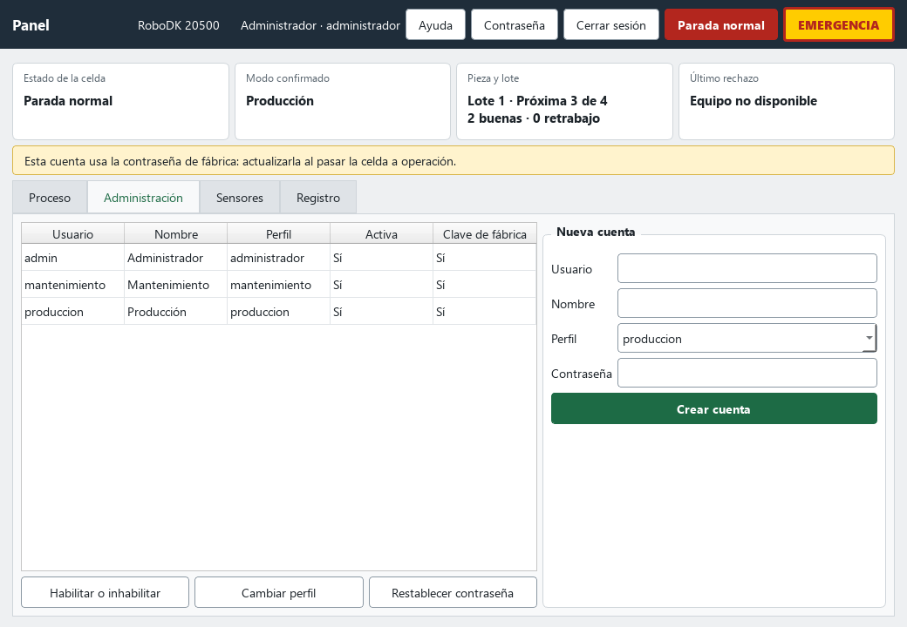

**UNIVERSIDAD TECNOLÓGICA NACIONAL** 
**Facultad Regional Córdoba** 
Licenciatura en Automatización y Control

**Cátedra: Robótica Industrial**

# Manual del panel de operador

Celda de soldadura TIG de paquetes de estator · Versión compatible: v05

**Grupo 4** 
Casali Emiliano · Ferrero Facundo · Vera Gonzalo

**Docentes** 
Ing. Julián Luque · Lic. Sergio Perassi

Comisión 2LA1 · Año 2026

## Índice

- [Prólogo](#prólogo)
- [1. Alcance y límites](#1-alcance-y-límites)
- [2. Puesta en marcha](#2-puesta-en-marcha)
- [3. Inicio de sesión y perfiles](#3-inicio-de-sesión-y-perfiles)
- [4. Pantalla general](#4-pantalla-general)
- [5. Producción](#5-producción)
- [6. Mantenimiento](#6-mantenimiento)
- [7. Sensores y registro](#7-sensores-y-registro)
- [8. Administración](#8-administración)
- [9. Causas de rechazo](#9-causas-de-rechazo)
- [10. Situaciones especiales](#10-situaciones-especiales)
- [11. Limitaciones conocidas](#11-limitaciones-conocidas)
- [12. Referencias](#12-referencias)

## Prólogo

Este manual explica cómo operar la celda v05, con el panel o sin él. Está dirigido a quien la
opera, la mantiene o administra sus cuentas, y a quien evalúa la simulación. Describe únicamente
funciones probadas; los resultados están en [panel_v05.json](../verificaciones/panel_v05.json). Fecha
de revisión: **2026-11-06**. Versión de RoboDK utilizada: **6.1.1**.

## 1. Alcance y límites

El panel muestra el estado de la celda y envía solicitudes. **No mueve robots ni la cinta:** todos
los movimientos y la secuencia son programas nativos de RoboDK, y el coordinador nativo decide si
cada solicitud se ejecuta.

- **Parada normal no es una parada de emergencia.** La celda termina y deposita la pieza en curso.
  Una solicitud no interrumpe un movimiento.
- **Las entradas de simulación no son protecciones.** Representan señales externas de la celda.
- **El panel no acredita energía cero.** El aislamiento y el bloqueo se hacen por procedimiento, fuera
  del panel.
- **El inicio de sesión protege el panel, no RoboDK.** Otro programa con acceso a la API puede
  modificar los parámetros de la estación.

## 2. Puesta en marcha

La celda se entrega en un solo archivo: `Celda_Soldadura_Estator_Grupo4_v05.rdk`. El panel va
dentro de la estación, y no hace falta ningún otro archivo ni usar una terminal. En el árbol de
RoboDK, un programa se ejecuta con doble clic.

**Ciclo sin panel.** Doble clic en `Programa_Principal`. Es el ciclo nativo: suelda un lote de cuatro
estatores y termina. No usa Python ni el panel.

**Con el panel:**

1. Doble clic en `Coordinador_Panel`. Queda esperando solicitudes y ningún equipo se mueve. El panel
   no lo inicia: los programas de la celda se ejecutan desde RoboDK.
2. Doble clic en `Panel_Operador`. Se abre la ventana del panel.

Si un programa queda a medias, reabrir la estación antes de usar el otro. El botón **Ayuda** resume
estos pasos, también sin iniciar sesión.

Al terminar, cerrar RoboDK **sin guardar**: guardar conserva el estado de la simulación en el archivo.

**Para desarrollo.** Desde el repositorio, el panel también se abre con
`C:\RoboDK\Python-Embedded\python.exe c_prototipado\panel\panel.py`, opcionalmente con
`--puerto 20501`. Cambiar `panel/` no modifica el `.rdk`: hay que regenerar la v05.

## 3. Inicio de sesión y perfiles

Al abrir por primera vez, el panel crea su base de datos en la máquina del usuario, con estas
cuentas de puesta en marcha:

| Usuario | Contraseña inicial | Perfil |
|---|---|---|
| `admin` | `admin` | Administrador |
| `mantenimiento` | `mantenimiento` | Mantenimiento |
| `produccion` | `produccion` | Producción |

**Estas contraseñas deben actualizarse al pasar la celda a operación.** Mientras sigan vigentes, el
panel muestra un aviso. Para cambiar la propia, usar **Cambiar contraseña** en la banda superior; la
nueva debe tener al menos 8 caracteres.

| Operación | Producción | Mantenimiento | Administrador |
|---|---|---|---|
| Consultar estado, sensores y registro | Sí | Sí | Sí |
| Parada normal | Sí | Sí | Sí |
| Arranque | Sí | No | No |
| Preparar modo y regresar | No | Sí | No |
| Entradas de simulación | No | Sí | No |
| Gestionar cuentas | No | No | Sí |

Cada perfil ve solo lo que tiene permitido, y el permiso se comprueba otra vez al procesar la orden.
La parada normal está disponible también sin sesión y queda registrada como `sin sesión`.

**Cierre de sesión.** La sesión termina con **Cerrar sesión**, a los 15 minutos de inactividad, al
perder la conexión o si un administrador cambia la cuenta. Si hay producción al cerrar, se pide la
parada normal, salvo con la conexión perdida. Cerrar sesión nunca abre la pinza ni reinicia el lote.

Cinco contraseñas incorrectas seguidas bloquean la cuenta durante 5 minutos.

## 4. Pantalla general

La banda superior muestra conexión, usuario y perfil, y el botón **Parada normal**. Debajo, cuatro
tarjetas indican:

| Tarjeta | Significado |
|---|---|
| Estado de la celda | Inicial, Automático, Parada normal, Detenida por condición perdida, Preparando modo, Regresando de modo o Modo confirmado. |
| Modo confirmado | Producción o el equipo intervenido. Lo confirman los sensores, no la selección. |
| Pieza y lote | Pieza en curso o próxima, piezas hechas y lotes completados. |
| Último rechazo | Causa del último rechazo, aunque ya esté resuelta. Ver [causas](#9-causas-de-rechazo). |

La franja amarilla avisa si falta algo para operar. «Lotes» cuenta las ejecuciones de `Fin_Lote`.

## 5. Producción

Con el perfil de producción:

1. **Preparación.** Mantenimiento debe haber marcado el permiso y la disponibilidad de los equipos
   ([§6](#6-mantenimiento)). Sin esto, las **Condiciones de arranque** muestran qué falta.
2. **Arranque.** Se habilita cuando se cumplen todas las condiciones. La primera vez ejecuta
   `Inicio_Celda`.
3. **Parada normal.** La celda termina la pieza, la deposita y se detiene.
4. **Continuación.** Un nuevo **Arranque** sigue desde la próxima pieza, sin repetir ninguna.
5. **Fin de lote.** Tras la cuarta pieza, la celda ejecuta `Fin_Lote` y sigue con el lote siguiente.
   Si se detuvo en ese punto, el fin de lote se ejecuta en el próximo arranque.

Si se pide arranque y parada a la vez, prevalece la parada.

## 6. Mantenimiento

Con el perfil de mantenimiento:

**Entradas de simulación.** `Permiso de operación` y las disponibilidades de IRB, CRB y cinta
comienzan apagadas. Marcarlas antes de operar. Desmarcar una disponibilidad simula una avería.

**Preparar.** Elegir equipo o tarea y tipo de intervención, y pulsar **Preparar**:

| Selección | Qué hace la celda |
|---|---|
| IRB 1200 y pinza | Lleva el IRB a mantenimiento. |
| CRB 1300 | Lleva el CRB a mantenimiento. |
| Ambos robots | Lleva primero el IRB y después el CRB. |
| Cinta | No mueve nada. |
| Servicio de antorcha | Lleva el CRB a la posición de cambio de tungsteno. |
| Correctivo sin movimiento | No mueve nada. Se admite con equipo averiado, sin permiso y en cualquier postura. |

Si hay producción, la primera solicitud detiene la celda al terminar la pieza e informa
«Producción detenida: reenviar la solicitud». Pulsar **Preparar** otra vez.

Esperar a que **Modo confirmado** muestre el equipo. Recién entonces corresponde el procedimiento
de aislamiento y acceso, descrito en [modos y mantenimiento](modos_y_mantenimiento.md).

**Regresar.** Al terminar, pulsar **Confirmar restitución y regresar**. Se declara terminada la
intervención, con resguardos cerrados y nadie dentro. Los robots vuelven a reposo y la celda queda
detenida: **no arranca sola**. El lote conserva su estado, y el perfil de producción debe dar un
nuevo arranque.

Para salir del correctivo, los equipos deben estar disponibles y los robots en reposo.

## 7. Sensores y registro

**Sensores** lista cada señal con su valor y su procedencia: calculada por Python o entrada simulada.

**Registro** muestra fecha, usuario, perfil, operación, detalle y resultado. Una orden aparece como
«Enviada» y luego como «Confirmada» o «Rechazada», según el resultado del coordinador. No guarda
contraseñas.

## 8. Administración

Con el perfil de administrador:

- **Nueva cuenta:** completar los datos y pulsar **Crear cuenta**.
- **Habilitar o inhabilitar, Cambiar perfil, Restablecer contraseña:** seleccionar la cuenta y pulsar
  el botón. Los cambios invalidan las sesiones abiertas de esa cuenta.

Una cuenta no puede cambiar sus propios privilegios, y siempre debe quedar una cuenta administradora
activa. El perfil de administrador no da permisos de producción ni de mantenimiento.

**Datos y recuperación.** Las cuentas y el registro se guardan en
`%LOCALAPPDATA%\Celda_Soldadura_Grupo4\panel.db`, y son propios de cada máquina. Si se pierde el acceso
de administrador, cerrar el panel y borrar ese archivo: al abrir, se recrean las cuentas iniciales.
**Esto borra también el registro de operaciones.**

## 9. Causas de rechazo

| Causa | Qué revisar |
|---|---|
| Sin permiso de operación | Marcar el permiso en entradas de simulación. |
| Cambio de modo en curso | Esperar a que termine. |
| Sensores no válidos | Comprobar que el panel siga conectado. |
| Equipo fuera de la posición requerida | Un robot no está donde hace falta. Ver [§10](#10-situaciones-especiales). |
| Pieza sujeta | Hay un estator en la pinza. No se abre automáticamente. |
| Cinta en movimiento | Esperar a que se detenga. |
| Equipo no disponible | Reparar el equipo y marcarlo disponible. |
| Hay un modo activo | Regresar primero; no se pasa de un modo a otro directamente. |
| No hay modo del cual regresar | No hace falta regresar. |
| Falta confirmar la restitución | Usar el botón de regreso. |
| Modo desconocido | Selección no válida; no afecta a la producción. |
| Producción activa | La celda ya está produciendo. |
| Arranque simultáneo con una parada | Prevaleció la parada; volver a pedir el arranque. |

## 10. Situaciones especiales

**Sin conexión.** Si RoboDK se cierra o se pierde la conexión, se cierra la sesión y se bloquean los
mandos. Las órdenes sin confirmar se descartan y no se reenvían al reconectar. La celda sigue con lo
que estaba haciendo: para detenerla, usar RoboDK.

**Coordinador detenido.** La franja amarilla lo indica. Doble clic en `Coordinador_Panel`.

**Sin PySide2.** Si el Python configurado en RoboDK no la trae, el panel intenta usar el de la
instalación de RoboDK; si tampoco está, avisa con un mensaje. El ciclo de `Programa_Principal` no
depende de esto.

**Avería durante la producción.** Al desmarcar una disponibilidad, la celda se detiene al terminar
la pieza y no ordena mover el equipo no disponible. Usar **Correctivo sin movimiento**.

**Detenida por condición perdida.** Se perdió el permiso, los sensores o la disponibilidad de un
equipo. Corregir la causa y dar un nuevo arranque: recuperar la condición no arranca la celda.

## 11. Limitaciones conocidas

- Una señal `SENSORES_VALIDOS` no acredita vigencia: si el panel se cierra de forma abrupta, queda
  en 1 y RoboDK no lo detecta.
- Con un equipo fuera de reposo no hay recuperación supervisada: el correctivo no puede cerrarse
  desde el panel.
- El rechazo por pieza sujeta no se ensayó.
- Cada cuenta tiene un solo perfil.
- No hay reconocimiento de alarmas ni rearme, ni entradas de puerta, cortinas o emergencia.
- La cinta no tiene evacuación ni vaciado desde el panel.
- Cerrar sesión con la conexión perdida no puede pedir la parada.

## 12. Referencias

- [Panel de operador y sensores](panel_y_sensores.md): decisiones, señales y ensayos.
- [Modos y mantenimiento](modos_y_mantenimiento.md): paradas, LOTO y tareas.
- [Concepto 09 · Interfaz de operación, usuarios y permisos](../../b_investigacion/conceptos/09_interfaz_de_operacion_usuarios_y_permisos.md).
- [Evidencia de los ensayos del panel](../verificaciones/panel_v05.json).
