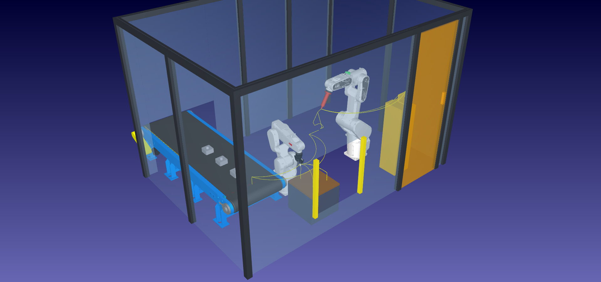
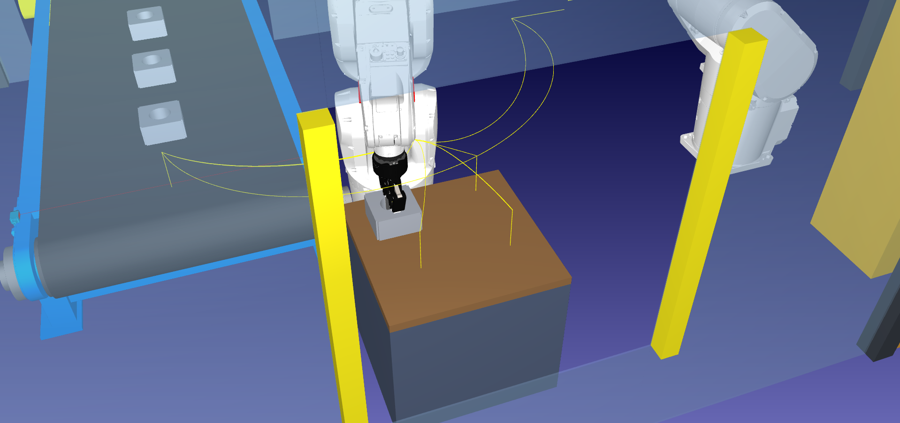
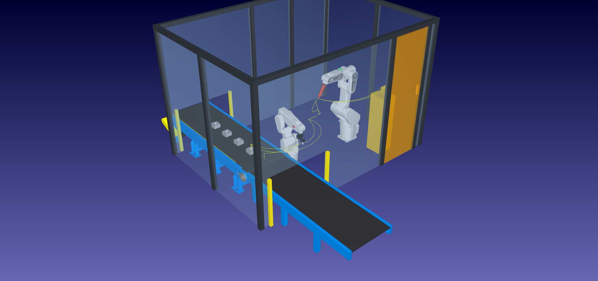
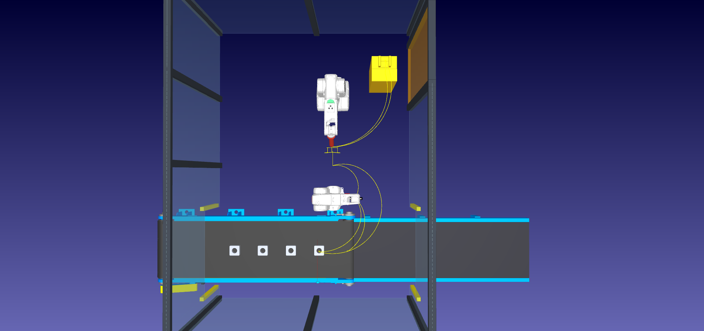
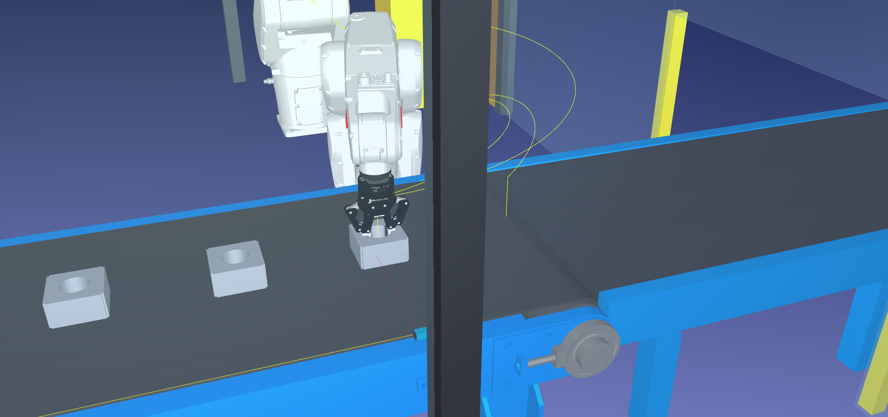
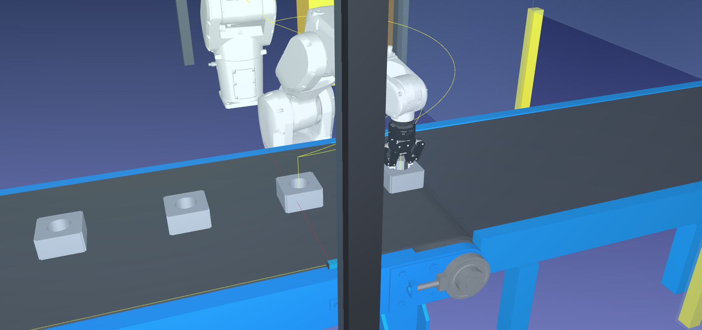
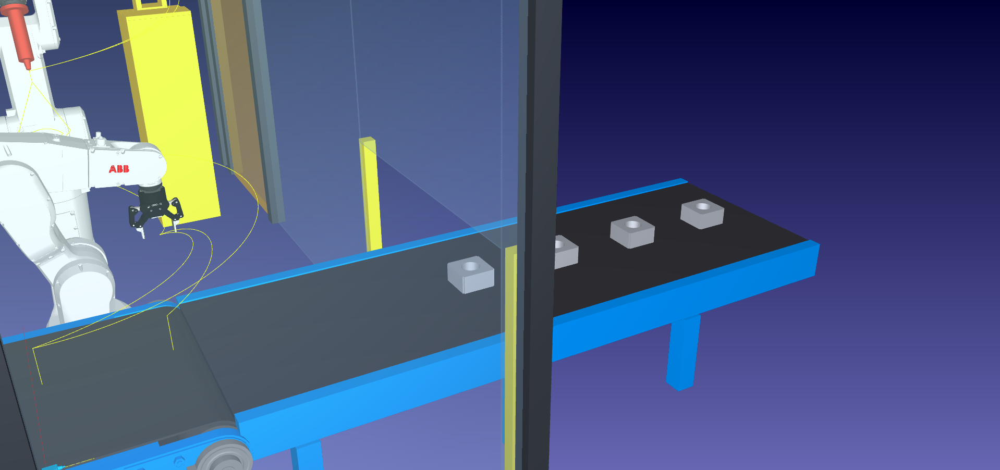

**UNIVERSIDAD TECNOLÓGICA NACIONAL** 
**Facultad Regional Córdoba** 
Licenciatura en Automatización y Control

---

**Cátedra: Robótica Industrial** 
Trabajo final: celda robotizada de soldadura

# Mejora 01 · Cinta pasante

*De la v02 (salida por pallet) a la v03 (entrada y salida por la misma cinta)*

**Grupo 4** 
Casali Emiliano · Ferrero Facundo · Vera Gonzalo

**Docentes** 
Ing. Julián Luque · Lic. Sergio Perassi

Comisión 2LA1 · Año 2026

---

## Índice

- [Prólogo](#prólogo)
- [1. Problema de la v02](#1-problema-de-la-v02)
- [2. Propuesta](#2-propuesta)
- [3. Cambios](#3-cambios)
- [4. Funcionamiento de la cinta pasante](#4-funcionamiento-de-la-cinta-pasante)
- [5. Seguridad](#5-seguridad)
- [6. Requisitos de la cátedra](#6-requisitos-de-la-cátedra)
- [7. Implementación](#7-implementación)
- [8. Verificación y resultados](#8-verificación-y-resultados)
- [9. Pendientes](#9-pendientes)
- [10. Archivos](#10-archivos)
- [11. Referencias](#11-referencias)

---

## Prólogo

Este documento registra la primera mejora de la celda definida en
[`definicion_celda.md`](definicion_celda.md). La propuso el grupo después de construir y probar la
v02: **sacar las piezas soldadas por la misma cinta que las trae**, en lugar de dejarlas en un
pallet que el operario retira desde la celda.

| Versión | Archivo | Descripción |
|---|---|---|
| v01 | [`Celda_Soldadura_Estator_Grupo4_v01.rdk`](Celda_Soldadura_Estator_Grupo4_v01.rdk) | Versión original: posicionador MTD 250, cilindro de 6 cordones |
| v02 | [`Celda_Soldadura_Estator_Grupo4_v02.rdk`](Celda_Soldadura_Estator_Grupo4_v02.rdk) | Manipulador + soldador; entrada por cinta, salida por pallet |
| **v03** | [`Celda_Soldadura_Estator_Grupo4_v03.rdk`](Celda_Soldadura_Estator_Grupo4_v03.rdk) | **Esta mejora:** entrada y salida por la misma cinta |

---

## 1. Problema de la v02

En la v02 el manipulador deja cada estator soldado en un pallet de 4 posiciones. Cuando el pallet
se llena, el operario lo retira por una **ventana del cerramiento**, protegida por una cortina de
luz.

| Vista general de la v02 | Depósito en el pallet (v02) |
|---|---|
|  |  |

La cortina detiene el robot si se la interrumpe, pero el problema de fondo sigue:

- **El operario introduce los brazos, y parte del cuerpo, en la celda** para alcanzar y sacar un
  pallet de 400 × 400 mm con 4 piezas (~14,4 kg de piezas, más el pallet).
- La ventana es un **acceso más** al volumen de trabajo del manipulador. Barrientos cuenta el
  **acceso indebido de personal a la zona de trabajo** entre las causas de accidentes y destaca la
  importancia de impedir ese acceso mientras el robot funciona [Barrientos, 9.3.1 y 9.3.2,
  pp. 272–273].
- El retiro del pallet es una **interrupción manual periódica** del flujo de piezas.

## 2. Propuesta

**La misma cinta entra y sale de la celda.** Se prolonga la banda para que atraviese el cerramiento
de oeste a este:

1. El operario carga los estatores en la cinta, **afuera** de la cara oeste.
2. La cinta los trae a la **toma**.
3. El manipulador toma uno, lo presenta al soldador y lo devuelve soldado a la **misma banda**, en
   el **punto de depósito**, aguas abajo de la toma.
4. La cinta lleva la pieza soldada **afuera** de la cara este, donde se retira.

El operario no tiene que alcanzar ningún objeto dentro de la celda: carga y descarga, ambas,
ocurren fuera del cerramiento. Es la medida de "dispositivos de intercambio de piezas" de Barrientos
[Barrientos, 9.3.2, p. 274] llevada a las dos puntas del proceso, y la estructura de celda
automatizada con transferencia automática de piezas de Groover [Groover, 14.2.1, p. 369].

## 3. Cambios

| Aspecto | v02 | v03 |
|---|---|---|
| Salida de piezas | Pallet 2 × 2 sobre soporte | **La misma cinta**, por la cara este |
| Cinta | Modelo ConveyorA, termina dentro de la celda | Modelo ConveyorA + **tramo de salida** propio hasta afuera |
| Toma | x = 120 mm | **x = −150 mm** |
| Depósito | 4 posiciones del pallet | **Un punto sobre la banda, x = +150 mm** |
| Programas de depósito | `Man_Depositar_P1` a `P4` | **`Man_Depositar_Cinta`** (único) |
| Fin de lote | Verificación de TCP + retorno de la cinta | Verificación de TCP + **evacuación** del lote soldado |
| Cara este del cerramiento | Ventana del pallet + puerta | **Abertura de salida de la cinta** + puerta |
| Cortinas de luz | Una, en la ventana del pallet | **Dos**: entrada (oeste) y salida (este) de la cinta |
| Operario | Introduce el cuerpo para retirar el pallet | **No entra**: carga y descarga afuera |

| Vista general de la v03 | Planta de la v03 |
|---|---|
|  |  |

**Lo que no cambia:** robots, herramientas, zona de soldadura, programas de presentación y
soldadura (incluido el MoveC de transición), estación de servicio y puerta.

## 4. Funcionamiento de la cinta pasante

La toma y el depósito están sobre la misma banda, **separados un paso de cinta** (300 mm) y
simétricos respecto de la base del manipulador, para que los dos queden igual de cerca (a ~580 mm
de su base, con 703 mm de alcance).

| Toma (x = −150 mm) | Depósito (x = +150 mm) |
|---|---|
|  |  |

**Secuencia del ciclo k:**

1. `Cinta_Avanzar_k`: la cinta avanza un paso. Trae el estator k a la toma y, al mismo tiempo, corre
   un paso hacia la salida la pieza soldada en el ciclo anterior, **dejando libre el depósito**.
2. `Man_Tomar_Cinta`: el manipulador toma el estator k.
3. Presentación y soldadura de los dos lados, sin cambios.
4. `Man_Depositar_Cinta`: el manipulador apoya la pieza soldada en el depósito y la suelta. El evento
   de soltar la deja colgada de `Frame_Piezas_Soldadas`, un frame solidario a la banda, así que
   desde ese momento avanza con la cinta.

Como la separación entre toma y depósito es exactamente un paso, **nunca hay dos piezas en el mismo
lugar**: la soldada siempre se corre antes de que llegue la siguiente.

**Fin de lote:** después de la cuarta pieza, `Fin_Lote` hace la verificación del TCP y
`Cinta_Evacuar` avanza la cinta hasta sacar las 4 piezas soldadas fuera del cerramiento.

| Piezas soldadas saliendo por la cara este |
|---|
|  |

## 5. Seguridad

| Medida | v02 | v03 |
|---|---|---|
| Aberturas del cerramiento | Túnel de la cinta (oeste), ventana del pallet (este), puerta | Túnel de entrada (oeste), túnel de salida (este), puerta |
| Cortinas de luz | Ventana del pallet | **Entrada y salida de la cinta** |
| Acceso del operario en operación normal | Brazos y torso por la ventana | **Ninguno**: solo la puerta, con la celda detenida |
| Objetos que el operario manipula | Pallet con 4 piezas (~14,4 kg más el pallet) | Una pieza por vez, en la cinta y afuera |

- **Los túneles de la cinta** tienen la altura justa para el paso de las piezas (700 mm). La cortina
  de cada uno detiene el robot si algo más que la cinta y las piezas cruza la abertura: es la
  aplicación de la cortina en ventanas de carga de la clase 2 [Clase 2], ahora en las dos puntas.
- **La única vía de entrada de una persona es la puerta enclavada**, frente a la estación de
  servicio, y se usa solo con la celda detenida (mantenimiento, cambio de tungsteno).

## 6. Requisitos de la cátedra

| Requisito | v02 | v03 |
|---|---|---|
| C1 · Frames y TCP propios | Sí | Sí. Se agrega `Frame_Deposito_Cinta` |
| C2 · Programa principal con subprogramas | Sí | Sí. Un programa de depósito en lugar de cuatro |
| C3 · Cinta, segundo robot o variantes de patrón | Los tres | **Cinta y segundo robot**. El patrón de pallet se elimina a propósito |
| C4 · Simulación válida | Sí | Sí (§8) |
| Movimientos MoveJ, MoveL, MoveC | Sí | Sí, sin cambios |
| Sin Python en los movimientos | Sí | Sí. La cinta se mueve con `MoveJ` nativos y la pieza con eventos de simulación |

El requisito C3 pide **al menos uno** de los tres elementos. El pallet era una opción válida, pero
la v03 lo reemplaza porque la cinta pasante es mejor solución para el operario. La celda sigue
cumpliendo C3 con la cinta y el segundo robot.

## 7. Implementación

La v03 se genera con [`scripts/mejora_01_cinta_pasante.py`](scripts/mejora_01_cinta_pasante.py)
**a partir del archivo de la v02**, y no reconstruyendo desde cero. Así se conservan los eventos de
simulación de tomar y soltar que se cargaron a mano en la interfaz de RoboDK.

| Paso del script | Qué hace |
|---|---|
| 1 | Abre la v02, la renombra `Celda_Soldadura_Estator_Grupo4_v03` y renombra la cinta `Cinta_Pasante` |
| 2 | Quita el pallet, su soporte, su cortina y el cerramiento v02; borra `Man_Depositar_P1…P4`, sus targets y `Cinta_Reinicio_Lote` |
| 3 | **Reutiliza el frame del pallet:** lo cuelga de `Frame_Banda` con pose nula y lo renombra `Frame_Piezas_Soldadas`. El evento de soltar sigue apuntando a ese frame (por referencia, no por nombre), así que las piezas soltadas quedan sobre la banda |
| 4 | Agrega el tramo de salida de la cinta, el cerramiento v03 y las cortinas de entrada y salida |
| 5 | Mueve la toma a x = −150, crea `Frame_Deposito_Cinta` en x = +150 con sus targets, y reubica el sensor y los estatores del lote |
| 6 | Crea `Man_Depositar_Cinta` y `Cinta_Evacuar`; reescribe `Ciclo_Pieza_1…4` y `Fin_Lote` |
| 7 | Desactiva solo los contactos previstos (estator apoyado sobre el tramo de salida) y guarda la v03 |

Los modelos nuevos los genera [`scripts/generar_modelos.py`](scripts/generar_modelos.py):
`cinta_extension_banda.stl`, `cinta_extension_estructura.stl`, `cortina_luz_cinta.stl` y el
cerramiento `*_v03.stl`. Los parámetros están en la sección "Mejora 01" de
[`scripts/parametros_celda.py`](scripts/parametros_celda.py).

**Cómo se prolonga la cinta:** el modelo de la biblioteca tiene una longitud fija (~2,05 m de
banda). El tramo de salida es geometría fija que continúa la banda con el mismo ancho (600 mm) y la
misma altura (366,5 mm). Todo lo que viaja sobre la banda cuelga de `Frame_Banda` y lo mueve **el
único eje** del mecanismo, como en una cinta real con un solo accionamiento.

## 8. Verificación y resultados

- **Alcance:** los targets de toma y depósito son alcanzables; 0 targets fuera de alcance.
- **Colisiones:** `verificar_celda.py --colisiones --con-pieza --estacion
  Celda_Soldadura_Estator_Grupo4_v03`: todos los programas válidos y sin colisiones, con muestreo
  de 1 mm.
- **Ejecución real del `Programa_Principal` con los eventos:** sin colisiones. Cada estator recorre
  `Frame_Banda` → `TCP_Pinza` → `Frame_Piezas_Soldadas` y sale de la celda por la cara este
  (x = 850 mm) hasta x = 1000 a 1900 mm.
- **Bucle (requisito C4):** con los eventos de reposición cargados, se ejecutaron **dos lotes
  seguidos** sin colisiones. Al terminar cada lote, la cinta vuelve a 0 y los 4 estatores quedan en
  la misma posición relativa de inicio (1680, 1380, 1080 y 780 mm sobre la banda), así que el lote
  siguiente arranca desde el mismo estado.

| Medida | v02 | v03 |
|---|---|---|
| Ciclo de una pieza | 75,7 s | 73,6 a 75,2 s |
| Fin de lote | 12,7 s | 18,1 s (incluye la evacuación) |
| Lote de 4 piezas | 321,4 s | ≈ 315 s (311 a 318 s en tres mediciones) |
| Tc por pieza | 80,4 s | ≈ 79 s |
| Tasa de ciclo | ≈ 45 piezas/h | ≈ 45 piezas/h |

**La mejora no busca velocidad:** el tiempo de ciclo es prácticamente el mismo. Lo que mejora es la
**seguridad** (nadie entra a la celda en operación normal) y el **flujo** (no hay que detener el
proceso para cambiar un pallet).

## 9. Pendientes

1. ✔ **Reposición del lote para el bucle.** Cargada al final de `Fin_Lote` con dos eventos de
   simulación nativos (*Instrucción de Simulación de Evento*):
   - **Ajustar las articulaciones al inicio** de `Cinta_Pasante` ("Inicio Cinta_Pasante"): vuelve
     el eje de la cinta a 0 de forma instantánea, sin que se vea a la banda retroceder;
   - **Fijar la posición del objeto (relativa)** ("Mover objetos"), con los 4 estatores: guarda su
     posición de inicio de lote respecto de la banda y la restaura al ejecutarse.

   Representan al operario que, afuera, retira las piezas soldadas y carga el lote siguiente. El
   `Programa_Principal` puede ejecutarse en bucle (§8).
2. **Medidas reales** del estator, igual que en la v02.

**Nota sobre la licencia de RoboDK:** la licencia de prueba solo se valida, y permite guardar
estaciones con varios robots, si RoboDK se ejecuta **como administrador** y con conexión a
internet. Sin eso, RoboDK aplica los límites de la licencia gratuita y no guarda la estación.

## 10. Archivos

| Archivo | Contenido |
|---|---|
| `Celda_Soldadura_Estator_Grupo4_v03.rdk` | Estación v03 |
| `scripts/mejora_01_cinta_pasante.py` | Genera la v03 a partir de la v02 |
| `scripts/generar_modelos.py`, `scripts/parametros_celda.py` | Modelos y parámetros de la mejora |
| `scripts/verificar_celda.py` | Verificación (con `--estacion` para elegir la versión) |
| `imagenes/v03/` | Capturas de este documento |

## 11. Referencias

- **[Barrientos]** Barrientos, A.; Peñín, L. F.; Balaguer, C.; Aracil, R. *Fundamentos de Robótica*.
  McGraw-Hill, 1.ª ed. Sección 9.3, pp. 271–277.
- **[Groover]** Groover, M. P. *Automation, Production Systems, and Computer-Integrated
  Manufacturing*, 4.ª ed. Pearson, 2015. Sección 14.2.
- **[Clase 2]** Luque, J. *Islas robotizadas y seguridad industrial*. UTN FRC, 2026.
- Grupo 4. [`definicion_celda.md`](definicion_celda.md) y
  [`componentesRDK.md`](../b_investigacion/componentesRDK.md).
