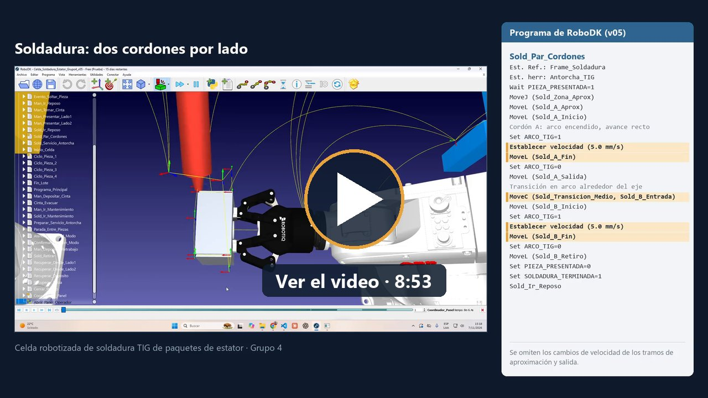

# Presentación

Productos finales del trabajo.

| Producto | Archivo | Estado |
|---|---|---|
| Estación de RoboDK | [Celda_Soldadura_Estator_Grupo4_v05.rdk](Celda_Soldadura_Estator_Grupo4_v05.rdk) | Copia de la v05 actual, con el panel embebido |
| Informe técnico | [Informe_Tecnico_Grupo4.pdf](Informe_Tecnico_Grupo4.pdf) | Generado, 7 páginas |
| Video de presentación | [Google Drive](https://drive.google.com/file/d/1jT9AAlhyzWE13D6R3_5kL27YfOVaF3MH/view?usp=drive_link) | 8:53, 1080p; la copia local no se versiona |

La estación es autosuficiente: no necesita ningún otro archivo del proyecto. Se usó RoboDK 6.1.1.

- **Sin panel:** doble clic en `Programa_Principal`.
- **Con panel:** doble clic en `Coordinador_Panel` y después en `Abrir_Panel_Operador`.

La estación de esta carpeta es una copia: si la celda se regenera, hay que reemplazarla. El informe se genera
desde [sus fuentes](../c_prototipado/docs/informe/) y el video, con los scripts de
[c_prototipado/video](../c_prototipado/video/).
